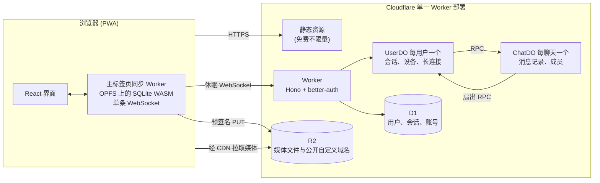

我做了个叫 [Web Chat](https://chat.vuiki.com) 的聊天应用，交互照着 Telegram 来的。

私聊和群聊支持回复、编辑、撤回、表情回应、置顶、转发、提及和已读回执，图片、视频、文件、语音消息和贴纸也都齐了。一对一和多人音视频通话带屏幕共享，多设备端到端加密的私密聊天也做了。装成 PWA 能收推送通知，断网还能照常翻记录。

这整套东西全跑在 Cloudflare 开发者平台上，目标就一个，塞进 **Workers 免费方案** 里，每个月一分钱不花。没有虚拟机，没有容器，没有 Redis，也没有 Postgres。每一个聊天都是一个带独立 SQLite 的 Durable Object，每一个用户也是。

零预算这根红线，最后改写了架构里的几乎每一个决定。

## 先算一笔免费额度的账

大部分架构文章都习惯从功能讲起，我这篇得反过来，先从账单算起。只要你决定每个月一分钱不花，免费方案里的那几条上限就会直接接管你的设计。

先看 2026 年 9 月 28 日这一版里卡脖子的额度。

| 产品 | 指标 | 免费额度 |
| --- | --- | --- |
| Workers | 请求数 | 100,000 / 天 |
| Workers | CPU 时间 | 10 ms / 次调用 |
| Durable Objects | 请求数 | 100,000 / 天 |
| Durable Objects | 活跃时长 | 13,000 GB-s / 天 |
| Durable Objects | SQL 写入行数 | 100,000 / 天 |
| Durable Objects | SQL 读取行数 | 5,000,000 / 天 |
| KV | 写入次数 | 1,000 / 天 |
| Queues | 操作次数 | 10,000 / 天 |
| Realtime SFU / TURN | 出站流量 | 1,000 GB / 月 |

把整套架构捏出形状的，主要是这里面的三条。

**SQL 写入行数** 最紧。每天十万行听起来不少，可索引更新算写入，`setAlarm()` 算写入，删一行数据也算写入。相比之下读取便宜了五十倍，所以我干脆拿读去换写，能少建一个索引就少建一个，小表直接扫也无所谓。

紧接着卡人的是 **活跃时长**，每天 13,000 GB-s。按每个对象 128 MB 算，整个账号一天加起来大概只有 **29 个对象小时**。只要有两个对象一直醒着不休眠，全天额度当场见底。凡是长连接或者长驻对象，都必须能随时休眠。

还有 **请求数**，群聊扇出最吃这一项，每次对 Durable Object 发起 RPC 调用都算一次。

剩下的几条额度基本直接把备选组件排除了。KV 每天只有 1,000 次写入，肯定不能放用户级或者消息级的数据。Queues 每天一万次操作，也进不了发消息的热路径。Cloudflare Images 每个月才给 5,000 次图片转换，缩略图只能另找地方算。

预算摊在桌上了，系统该长什么样也就清楚了。

## 每个聊天都是服务器，每个用户也是

聊天的业务拆到底，天然就有两块各自管各自的一致性边界。一块归聊天管，消息顺序、成员名单、谁有什么权限全看它。另一块归用户管，会话列表、登录过的设备、还有哪些消息没读，都在用户这边。

所以我只建了两种 Durable Object，背后各带一份 SQLite。

每个聊天对应一个 `ChatDO`，消息记录、序列号和成员名单都以它为唯一准星。每个用户对应一个 `UserDO`，手里攥着这个用户的会话列表，一个聊天占一行，顺便管着他的设备和推送订阅，所有设备的 WebSocket 也全连到这儿。

至于 D1，只留给 better-auth 存用户、会话和关联账号，再加上少数必须全局查的表。



这套结构看着挺大，靠几个小设计把开销压得很低。

私聊的聊天 ID 直接按规则拼出来，`p:{smaller user id}:{larger user id}`。点开一个私聊根本不用查全局目录，两个人同一秒给对方发消息也不会撞出两个重复会话。群聊 ID 则直接用 128 位随机值。

`ChatDO` 完全不对外暴露，外网流量碰不到它，只有 `UserDO` 和 Worker 能通过 RPC 调它。受信任的 `UserDO` 把调用者身份传进去，`ChatDO` 只管查成员资格和权限。数据归属也是单向的，成员关系以 `ChatDO.members` 为准，用户侧的会话列表只是派生视图，任何变动都先落到 `ChatDO`，再扇出给每个成员的 `UserDO`。

你可能会问，干嘛不把消息直接塞进 D1 呢？

我一开始也想过，可 D1 一个库同时只有一个写入者，全站聊天挤在一张库里抢写，序列号的并发竞争还得我自己写代码兜底，而且实时推送最后照样离不开 Durable Objects。要是退一步搞一个全局单例 Durable Object，它自己又成了瓶颈。拆成每个聊天一个对象以后，每个会话都自带一套小服务器和独立存储，单个对象每秒大约能扛 1,000 次请求，二十人小群怎么聊都打不满。

## 白捡来的并发正确性

用上 Durable Objects 之后，好几件平时得上锁、写事务才能保证的事，平台直接替你办了。

对象内部是单线程执行加输入门控的，在 `ChatDO` 里发下一个序列号天然串行，连锁都不用写。输出门控保证前面的 SQLite 写入落盘之前，响应绝不会发出去，客户端只要收到 `seq`，消息就肯定稳稳躺在磁盘里了。再加上 `ctx.storage.sql.exec` 本身是同步的，一次事件里的几条写操作天生具备原子性。

序列号这块，我借用了 Telegram MTProto 的思路，一共设了三个编号。

| 编号 | 作用域 | 递增时机 | 用途 |
| --- | --- | --- | --- |
| `seq` | 单个聊天 | 每来一条新消息 | 排序、分页、消息的永久编号 |
| `chat_pts` | 单个聊天 | 消息发生任何变化，包括新发、编辑、撤回、表情回应 | 单个聊天内的增量同步 |
| `user_pts` | 单个用户 | 会话行、设置、联系人或近期通话发生变动 | 同步整个聊天列表 |

编辑和撤回不会动 `seq`，但其他设备还是得增量把变化拉下来，所以每个聊天才拆出两个号。

按常规写法，很多人会单独建一行计数器，来一条消息就加一。可算算账就知道亏大了，每条消息都要白白多交一行写入，一直交到天荒地老。我干脆把计数器行砍了，每条消息自己记着自己的 `seq` 和 `pts`，对象醒来的时候扫一眼 `max()` 就恢复出来了。

```typescript
// server/src/chat-do.ts（构造函数中）
// 序列号不单独存计数器行，对象唤醒时直接用 max() 恢复
const tops = this.sql.one<{ seq: number | null; pts: number | null }>(
  'SELECT max(seq) AS seq, max(pts) AS pts FROM messages',
)
this.topSeq = tops?.seq ?? 0
this.chatPts = tops?.pts ?? 0
```

`UserDO` 的 `user_pts` 也照搬这招，把所有带 `pts` 列的表各自取最大值再比一遍。未读数同样不落库，什么时候要看，直接拿 `top_seq` 减去 `last_read_seq` 算出来就行。

## 一台设备只留一条休眠 WebSocket

聊完数据边界，回到连接这块。

每台设备只维持一条 WebSocket，直连自己对应的 `UserDO`，走 Hibernation API。这个选型全靠 Cloudflare 的三条计费规则撑着。

持有 WebSocket 但支持休眠的对象，闲着的时候不计活跃时长。进来的 WebSocket 消息按每 20 条算 1 次请求。用 `setWebSocketAutoResponse` 配好的自动回复压根不计费。

心跳包因此完全不会把对象吵醒，连接状态塞进 socket 的 attachment 里，睡醒照样还在。

```typescript
// server/src/user-do.ts（节选）
constructor(ctx: DurableObjectState, env: Env) {
  super(ctx, env)
  // ...
  // 运行时直接替对象回 pong，全程不唤醒对象
  ctx.setWebSocketAutoResponse(new WebSocketRequestResponsePair(PING, PONG))
}

override async fetch(request: Request): Promise<Response> {
  // ... Worker 已经验完会话并写好了身份请求头

  // 同一台设备只保留一条连接
  for (const old of this.ctx.getWebSockets(deviceId)) old.close(CLOSE_REPLACED, 'replaced')

  const { 0: client, 1: server } = new WebSocketPair()
  this.ctx.acceptWebSocket(server, [deviceId])
  // 连接状态放进 attachment，休眠唤醒后依然保留
  server.serializeAttachment({
    user_id: userId,
    device_id: deviceId,
    since: Date.now(),
    visible: false,
    hidden_at: 0,
    viewing: [],
  } satisfies Attachment)
  return new Response(null, { status: 101, webSocket: client })
}
```

几乎所有业务调用都走这条连接。发消息、翻历史记录、标已读、拉起通话，全是 WebSocket 上的数据帧，`UserDO` 收到后再走 RPC 转发给对应的 `ChatDO`。HTTP 只留给 WebSocket 干不了的活，比如登录登出、签上传链接、抓网页预览。进来的那一帧本身只占二十分之一次请求，也不扣 Workers 的请求配额，开销大头都在它背后触发的 `ChatDO` 和其他 `UserDO` RPC 上，后面算账的表记的也就是这笔。

为了保证对象真能睡着，我给每个对象定了条死规矩，里面绝不能出现 `setTimeout` 和 `setInterval`。只要挂着一个定时器，对象就一直醒着扣时长。需要过期的东西全靠存时间戳，读的时候再判断。实在得延后执行的任务走 Alarm，而且要把多次 `setAlarm` 合并起来，因为调一次就算一行写入。

其他方案我也掂量过。SSE 配 HTTP POST 会把每次上行发消息都变成一次 Worker 请求。每个打开的聊天单独连一条线到 `ChatDO`，连接数和请求数翻着跟头涨，聊天列表最后还是得再开一条用户级连接。长生命周期的 RPC 会话又得在内存里留状态，对象照样没法休眠。绕了一圈，还是单条休眠 WebSocket 最省心。

## 写扇出，以及为什么把群聊卡在 20 人

消息落进 `ChatDO` 之后，群里每个成员的 `UserDO` 都得知道，要改会话行、推给在线设备，离线设备还得补一条 Web Push。做消息分发老规矩就两条路，写扇出提前把事件抄给每个成员，读扇出等成员自己来拉。

要是做几千人的大频道，肯定得走读扇出。我其实画过一套分级方案，打算给大群做带租约的订阅。画到一半我停下来想了想，干脆做了个产品取舍，**频道先不做，群人数上限直接卡死在 20 人**。

这一刀下去，一下就清静了。写扇出有了铁打的上界，实时推送、离线补齐和未读统计共用同一套路径，代码少了一大截。

具体每一步花多少额度，我直接写进了自动化测试，拿 `sql.exec().rowsWritten` 做断言。谁要是改代码悄悄多写了一行，测试当场飘红。

| 操作 | DO 请求数 | DO 写入行数 |
| --- | --- | --- |
| 发送一条私聊消息 | ≈ 2.05 | 4 |
| 发送一条 N 人群聊消息（N ≤ 20） | ≈ N + 0.05 | N + 2 |
| 私聊标记已读 | ≈ 2.05 | 3 |
| 群聊标记已读 | ≈ 0.05 | 1 |
| 正在输入状态 | ≈ 1.05 + 正在查看人数 | 0 |

发一条私聊一共写 4 行，`ChatDO` 里占 2 行，分别是消息本身和它的 `pts` 索引项，收发双方的会话行各占 1 行。最坏情况发一次满员大群，也就是 20 次请求和 22 行写入。

扇出过程绝不拖着发送方等。事件先按用户排进内存队列合并，放到 `waitUntil` 里通过一个并发度为 6 的池子发出去，正好卡在单次调用最多 6 条并发连接的限制以内。重试表只在投递真失败的时候才写，正常路径一分钱不多花。

```typescript
// server/src/chat-do.ts（节选）
private async flush() {
  while (this.pending.size > 0) {
    const batch = [...this.pending]
    this.pending.clear()
    await pool(batch, FANOUT_CONCURRENCY, async ([userId, events]) => {
      try {
        await this.env.USER.getByName(userId).onChatEvents(this.chatId!, userId, events, this.snapshot)
      } catch (e) {
        // 只有投递失败才会写重试表，随后交给 Alarm 重试
        await this.enqueueRetry(userId, events)
      }
    })
  }
}
```

说到这儿，有个坑我得单独提一下，它是上线后翻生产日志才撞见的。

Cloudflare 运行时会限制子请求的嵌套深度，超了就报 `Subrequest depth limit exceeded`。有两个 `UserDO` 隔着一个 `ChatDO` 来回弹了一阵事件之后，其中一个对象在处理 WebSocket 消息时，连带着调 D1 和 R2 的请求全被拒了。偏偏从 Alarm 里发出去的调用一点事没有。所以扇出失败统一交给 Alarm 重试，如果 `UserDO` 在响应客户端时撞上这个错，就先把请求留在内存里，马上排一个立刻执行的 Alarm，在 Alarm 里把活干完再回客户端。这套嵌套深度到底怎么继承，官方文档里没写，全是我啃日志推出来的。

## 在 10 ms CPU 里挤出登录鉴权

Web Chat 自己不管密码，也没有注册表单。身份全靠外部 OpenID Connect 提供方，用 better-auth 的 Generic OAuth 插件接进来，D1 只存同步下来的用户、会话和关联账号。这样最吃 CPU 的密码哈希就彻底挪出了只有 10 ms CPU 的 Worker。

即便如此，better-auth 在免费套餐里还是有点重。我拿 `wrangler tail` 实测过免费方案上的热实例，`/ws` 建连升级时走 `auth.api.getSession` 要吃掉 31 到 51 ms 的 CPU。平台虽然偶尔放过了，可重连是整个应用最热的路径，指望平台网开一面迟早翻车。

后来我改了策略，Worker 进来先直接校验 better-auth 的紧凑型 cookie 缓存。只跑一次 HMAC，不初始化 better-auth，也不查 D1。这一改，升级建连的 CPU 开销直接掉到了 5 到 11 ms。只有等五分钟缓存过期了，才回退去走正常的会话查询。

另外两处改动顺手把 D1 也按安静了。会话每天最多续期一次，一个活跃登录一天撑死产生一行 D1 写入。设备管理也绕开了 better-auth，踢掉一台设备时，直接让 `UserDO` 删掉 D1 里对应的会话行，同时掐断那台设备的连接。被踢掉的设备手里还捏着最多五分钟有效的 cookie 缓存，所以 `UserDO` 顺手记一笔已移除设备的名单，五分钟内要是还敢重连，当场关掉。

## 一天下来到底花多少

把前面每一笔单价乘起来，免费方案能养活多大的小圈子就有数了。按 100 个日活算，每人每天发 30 条私聊，加上 5 个满员 20 人群、每个群每天聊 200 条，再算上已读回执、正在输入、重连和在线状态续期，账单长这样。

| 项目 | DO 请求数 | DO 写入行数 |
| --- | --- | --- |
| 3,000 条私聊消息 | 6,150 | 12,000 |
| 1,000 条群聊消息 | 20,050 | 22,000 |
| 约 1,300 次已读回执 | 2,700 | 3,900 |
| 约 4,000 次正在输入 | 约 6,000 | 0 |
| 约 1,000 次连接建立 | 1,000 | 约 1,000 |
| 约 3,600 次在线状态续期 | 约 11,000 | 0 |
| **合计** | **约 47,000 / 100,000** | **约 39,000 / 100,000** |

也就是说，免费方案稳稳托住 **100 到 200 日活** 的小社区没什么问题。真涨到顶，最先撞墙的会是群聊扇出，好在 20 人上限把天花板按死了。往后实在不够用，第一步可以调长已读、输入状态和在线续期的节流间隔，再往后就花 5 美元一个月开 Workers Paid，写入额度直接蹦到每月五千万行，架构一行代码都不用动。

## 把能搬去本地的活，全塞进浏览器

服务端负责把成本兜住，客户端负责让打开和切换快得像本地软件，顺手还能替服务端卸掉一大块负担。

浏览器里跑着编译成 WASM 的 **SQLite**，数据用 `opfs-sahpool` VFS 存在 OPFS 里，归一个独立 Web Worker 管。界面层只读本地数据库，网络层唯一的任务就是把服务端数据同步进本地库。点开应用、切聊天窗口从来不用等网络，同步过的消息断网也能照看。

一个浏览器开好几个标签页怎么办？我用 Web Lock 选出一个主标签页。所有标签页一起抢同一把锁，抢到的那一个启动同步 Worker，独占本地库和那条 WebSocket，其余标签页通过 `BroadcastChannel` 跟它说话。主标签页一关，锁自动递给下一个标签页接班。不管用户开了多少个窗口，同一个源永远只有一条长连接。

你可能会好奇，干嘛不用 SharedWorker 呢？因为 SQLite 高速 VFS 依赖的 OPFS 同步访问句柄，目前只在 Dedicated Worker 里能用，SharedWorker 拿不到。

界面更新也没上重型状态管理库。同步 Worker 每次事务提交完，广播一下动了哪些主题，比如 `dialogs` 或者 `chat:{id}`。前端写了个大约一百行的 `useLiveQuery` Hook，套在 `useSyncExternalStore` 上，只重跑关心对应主题的查询。发消息先写本地发件箱、界面立刻乐观渲染，每条消息带着一个 `random_id`，`ChatDO` 靠它去重，就算切主标签页或者重试重放也不会发重。

搬到本地后最赚的一笔，是 **全文搜索**。

如果在服务端做搜索，SQLite 的 FTS 影子表会让每条消息的写入行数翻倍，偏偏写入行数是我最舍不得花的额度。搬到浏览器里就不心疼了，直接开 SQLite 的 FTS5 `trigram` 分词器，连中文子串搜索都一并解决，服务端压根不做全文搜索。

当然天下没有白来的便宜，服务端省下来的复杂度全转移到客户端了，同步状态机、序列号跳号时的空洞检测、主标签页交接，还有浏览器突然把运行中 Worker 底下的 OPFS 清掉之后怎么恢复，这些都得自己写稳。

## 不花钱买媒体服务器，文件怎么办

图片、视频、语音这些大块头，Worker 从头到尾不碰一个字节，也没接任何第三方图片处理服务。

压缩和转码全扔给浏览器自己干。图片用 `OffscreenCanvas` 缩放，编成 WebP，Safari 上回退成 JPEG。视频在 Web Worker 里拿 WebCodecs 转成 H.264 加 AAC 的 MP4，本来就达标的直接重新封装。语音录成 Opus，时长和波形图也在本地算好。消息里顺手内联一个大约 25 字节的 ThumbHash，原图还没开始下，模糊占位图就已经贴上去了。

上传直接走预签名 PUT 进 R2，分片上传也一样，Worker 只干签链接这一件事。下载走 R2 的自定义域名，对象键全是 128 位随机值且永不修改，CDN 直接按 `immutable` 缓存。看图看视频不消耗任何 Worker 请求，命中缓存连 R2 操作数都不算。这套访问模型走的是能力 URL，谁拿到链接谁就能读，需要保密的文件放进私密聊天里走加密通道就行。

用预签名直传会留一个尾巴，万一用户把文件传上去了，最后又把输入框关了没发消息呢？签名请求根本没经过 Durable Object，谁都不知道哪些文件成了孤儿。如果在 `UserDO` 里记一本上传账本，每批上传得白花大约两行写入。要是写个标记清除的 Workflow，又得把全站聊天扫一遍，漏扫一个还会误删正常图片。

最后我想了个土办法，居然特别好用。所有刚上传的文件先落在 `p/{user_id}/...` 这个待定前缀下。等消息发出去时，`UserDO` 把对象复制到 `m/` 下的同名路径，再交给 `ChatDO`。R2 配一条生命周期规则，`p/` 底下的东西七天后自动清掉。多出来的一次复制只花一个 R2 Class A 操作，这项免费额度宽裕得很，而我最金贵的 DO 写入行数，一行没花。

## 音视频通话怎么省出 1,000 GB

通话接的是 Cloudflare Realtime，SFU 和 TURN 共用每月 1,000 GB 的免费出站流量。为了把这 1,000 GB 花在刀刃上，我硬是把一对一和群聊拆成了两条完全不同的媒体路径。

一对一通话能直连就直连。信令直接搭在已经连着的 WebSocket 上，穿过双方的 `UserDO` 互传。ICE 用 Cloudflare 的 STUN 和 TURN，短期 TURN 凭证由 Worker 签发。只要两端能打通 P2P，媒体流压根不经过 Cloudflare，聊通宵也不花一兆流量。

不过陌生人除外。如果对方不在我的联系人列表里，我这边会强制设为 `iceTransportPolicy: 'relay'`，宁可绕一下中继，也不能把自己的网络地址漏出去。

群聊通话走 Realtime SFU。二十个人要是跑全网状 P2P，每个人得往上推十九路流，家用宽带直接趴窝。房间里谁在场、发了哪几路轨道，全存在群的 `ChatDO` 里。视频开了联播，九宫格小窗只拉低码率层，只有点开放大或者看屏幕共享时才切高码率。

心里可以大概估一下消耗。一对一视频单向大概 1.5 Mbps，全程走中继的话一小时约 1.35 GB，纯语音一小时只有 36 MB。五人视频群聊全开摄像头看九宫格，一小时大约吃掉 4.5 GB。

## 用 MLS 做多设备端到端加密

私密聊天是一对一的端到端加密会话，跟 Telegram 不同的是，它能同时在你的多台设备上用。底层走的是 MLS 协议，也就是 RFC 9420，库选的 `ts-mls`，每台设备作为 MLS 群组里的一个叶子节点。

新设备进群由老设备拉。每台设备提前在自己的 `UserDO` 里放几份一次性 KeyPackage，一旦新设备冒头，第一台在线的老设备就替它提交一个 Add 操作。新设备只能解开加入之后的消息。

不过 MLS 在这里只管成员变更和密钥演进，不管单条消息的加解密。每个纪元里，设备从 MLS exporter 派生出一把密钥，消息、编辑和表情回应都拿 AES-GCM 加密，再用发送设备的叶子密钥签名。因为同一份密文可以反复解开，编辑、表情回应、翻页和增量同步跟普通聊天长得一模一样。

服务端存密文的方式也跟普通消息没区别，老老实实放进私密聊天的 `ChatDO`，照样走 `seq`、`chat_pts` 和增量同步。我没做那种「所有设备确认收到就删密文」的机制，那样每条消息写入直接翻倍，还得给每台设备维护游标，其实也没多出多少安全性，毕竟 MLS 自己就会把用过的旧密钥删掉。

全部 MLS 运算都塞在客户端的同步 Worker 里，服务端只负责存、排序和校验设备列表对应的元数据，正好也能稳稳卡在 Worker 的 10 ms CPU 里。既然设备列表是从服务端拿的，怎么防服务端偷偷塞一台假设备进来？每台设备的公钥会一起算出一个 60 位安全码，只要有新设备加入，安全码就会变，聊天里也会弹一条系统提示。

这里有两件实话得摊开讲。`ts-mls` 目前没有经过正式的安全审计，而且在同一个纪元内部，做不到逐条消息前向保密。明文只存在设备本地，哪台设备要是把本地数据清空了，历史记录找不回来，只能当成一台新设备重新加进群。

## 为了塞进免费方案，我放弃了什么

选型做多了你就发现，免费架构有一半功夫花在决定「什么坚决不做」上。

我砍掉了大频道，把群聊死死卡在 20 人，换来写扇出的严格上界。浏览器只管最新常青版，OPFS、WebCodecs 和 Document Picture-in-Picture 直接裸用，一个兼容回退都没写。

数据库迁移从 1.0 起只往前滚。服务端和客户端的 schema 只加新版本不回退，碰到不兼容的协议变更，老客户端直接刷新重来。媒体链接走能力 URL，谁拿到链接就能看。普通聊天信任 Cloudflare，群聊通话也信任 Cloudflare，毕竟媒体流在 SFU 那一层会解开，真有隐私顾虑的内容就去私密聊天里发。

还有一件小遗憾，截至 2026 年 10 月，Cloudflare 免费方案还没有覆盖 Durable Objects 的自动额度告警，`rows_written` 和 `requests` 这两个数，我现在还得自己隔三岔五去后台盯着看。

## 试一试，或者自己部署一套

线上实例搭在 [chat.vuiki.com](https://chat.vuiki.com)，全部代码开源在 [Jazee6/web-chat](https://github.com/Jazee6/web-chat)。

仓库里放了 **Deploy to Cloudflare** 一键按钮，点一下就会把代码复制到你的 GitHub 或 GitLab，自动建好 D1 数据库、R2 存储桶和 Durable Objects，跑完迁移直接上线。唯一需要你自备的是一个用来登录的 OpenID Connect 提供方，我自己接的是同样跑在 Workers 和 D1 上的 [Easy Auth](/posts/easy-auth)。
