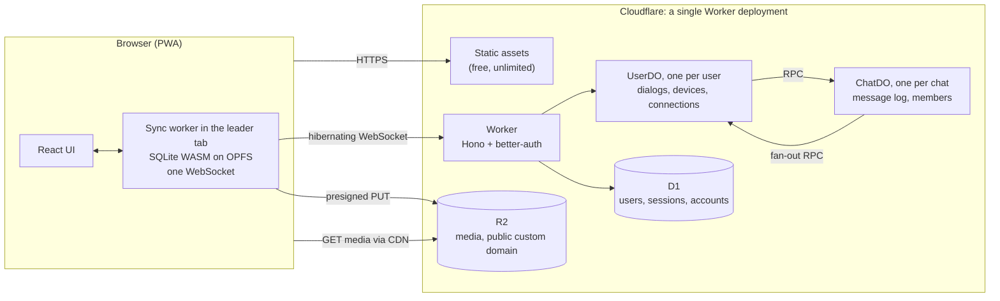

[Web Chat](https://chat.jaze.top) is a Telegram-style chat app. It has private chats and groups with replies, edits, recall, reactions, pins, forwarding, mentions and read receipts. There are photos, videos, files, voice messages and stickers; one-to-one and group calls with screen sharing; and secret chats with end-to-end encryption across multiple devices. It installs as a PWA, sends push notifications and works offline.

All of it runs on the Cloudflare developer platform, and it's designed to fit the **Workers Free plan**. There are no VMs, no containers, no Redis and no Postgres. Every chat is a Durable Object with its own SQLite database, and so is every user.

This post covers how that works and why the free plan ended up shaping nearly every decision in the architecture.

## The Budget

Most architecture write-ups start from the features. This one has to start from the bill, because once the bill has to be zero, the free plan's limits stop being a pricing detail and become the design constraints.

Here are the limits that matter, as of 2026-09-28:

| Product | Metric | Free allowance |
| --- | --- | --- |
| Workers | Requests | 100,000 / day |
| Workers | CPU | 10 ms / invocation |
| Durable Objects | Requests | 100,000 / day |
| Durable Objects | Duration | 13,000 GB-s / day |
| Durable Objects | SQL rows written | 100,000 / day |
| Durable Objects | SQL rows read | 5,000,000 / day |
| KV | Writes | 1,000 / day |
| Queues | Operations | 10,000 / day |
| Realtime SFU / TURN | Egress | 1,000 GB / month |

Three of these do most of the shaping:

- **Rows written** is the tightest. Indexes count as writes, `setAlarm()` counts as a write, and deletes count as writes. Reads are fifty times cheaper, so I happily trade reads for writes: fewer indexes, more scans of small tables.
- **Duration** is 13,000 GB-s a day. At 128 MB per object, that's about **29 Durable Object hours a day for the whole account**. Two objects that never hibernate would use it all up. Anything long-lived has to hibernate.
- **Requests** are where fan-out costs show up. Every RPC call to a Durable Object counts as one.

The others rule things out. KV's 1,000 writes a day means KV never holds per-user or per-message data. Queues' 10,000 operations a day keeps them off the message hot path. Cloudflare Images gives only 5,000 transformations a month, so thumbnails are made somewhere else.

With the budget in hand, here's the shape of the system.

## Every Chat Is a Server, and So Is Every User

A chat app has two natural consistency boundaries:

- **A chat** owns message order, membership and permissions.
- **A user** owns their chat list, devices and unread state.

So there are two kinds of Durable Objects, both backed by SQLite:

- One `ChatDO` per chat, which is the single source of truth for that chat's message log, its sequence numbers and its members.
- One `UserDO` per user, which owns the user's dialog list (one row per chat they're in), their devices and push subscriptions, and is also where all of that user's WebSockets land.

D1 holds only what better-auth needs (users, sessions, linked accounts), plus the lookups that have to be global.



A few details make this cheaper than it looks:

- **Chat IDs for private chats are deterministic**: `p:{smaller user id}:{larger user id}`. Opening a private chat never needs a directory lookup, and two people starting a chat at the same moment can't create two of them. Group IDs are random 128-bit values.
- **`ChatDO` is never exposed to the internet.** Only `UserDO`s and the Worker call it, over RPC. The trusted `UserDO` passes in who's calling, and the `ChatDO` checks membership and permissions.
- **Ownership flows one way.** Membership lives in `ChatDO.members`; a user's dialog list is a derived view. Every change is written to the `ChatDO` first and then fanned out to members' `UserDO`s.

Why not keep messages in D1? D1 is a single writer per database, so every chat in the system would contend for one database, and I'd have to handle sequence-number races myself. Real-time push would still need Durable Objects anyway. A single global Durable Object would just be a bottleneck. One object per chat gives every chat its own little server with its own storage, and a soft limit of around 1,000 requests per second per chat is far more than any group of 20 people will generate.

## Correctness for Free

Durable Objects bring a few guarantees that would otherwise need locks and transactions:

- **Single-threaded execution with input gates.** Assigning the next sequence number inside a `ChatDO` is naturally serial. There's no lock.
- **Output gates.** A response isn't sent until the SQLite writes before it are durable. When the client receives a `seq`, the message is already on disk.
- **Synchronous SQL.** `ctx.storage.sql.exec` is synchronous, so multiple writes within one event are implicitly atomic.

There are three sequence numbers, borrowed from Telegram's MTProto model:

| Number | Scope | Increments on | Used for |
| --- | --- | --- | --- |
| `seq` | Chat | Every new message | Ordering, pagination, the message's permanent ID |
| `chat_pts` | Chat | Any change to a message: new, edit, recall, reaction | Incremental sync within a chat |
| `user_pts` | User | Any change to a dialog row, setting, contact or recent call | Syncing the chat list |

Edits and recalls don't change `seq`, but devices still need to pick them up incrementally, which is why there are two numbers per chat.

The obvious way to keep these counters is a row that gets bumped on every message. That's one extra row write per message, forever. Instead, the counters aren't stored at all. Each message row records its own `seq` and `pts`, and when the object wakes up, it recovers the counters with `max()`:

```typescript
// server/src/chat-do.ts (in the constructor)
// Sequence numbers aren't stored in a counter row; they're recovered with max() on wake-up
const tops = this.sql.one<{ seq: number | null; pts: number | null }>(
  'SELECT max(seq) AS seq, max(pts) AS pts FROM messages',
)
this.topSeq = tops?.seq ?? 0
this.chatPts = tops?.pts ?? 0
```

`UserDO` does the same for `user_pts`, taking the maximum across every table that carries a `pts` column. Unread counts are never stored either: they're always `top_seq − last_read_seq`.

## One Hibernating WebSocket per Device

Each device keeps exactly one WebSocket, to its own `UserDO`, using the Hibernation API. Three billing rules make this the right shape:

- An object that holds a WebSocket but can hibernate isn't billed for duration while it's idle.
- Incoming WebSocket messages are billed at **20 messages per request**.
- Automatic responses set with `setWebSocketAutoResponse` aren't billed at all.

So the heartbeat never wakes the object, and per-connection state lives in the socket's attachment, where it survives hibernation:

```typescript
// server/src/user-do.ts (abridged)
constructor(ctx: DurableObjectState, env: Env) {
  super(ctx, env)
  // ...
  // The runtime answers ping with pong itself, without waking the object
  ctx.setWebSocketAutoResponse(new WebSocketRequestResponsePair(PING, PONG))
}

override async fetch(request: Request): Promise<Response> {
  // ... the Worker has already checked the session and set the identity headers

  // Keep only one connection per device
  for (const old of this.ctx.getWebSockets(deviceId)) old.close(CLOSE_REPLACED, 'replaced')

  const { 0: client, 1: server } = new WebSocketPair()
  this.ctx.acceptWebSocket(server, [deviceId])
  // Connection state lives in the attachment so it survives hibernation
  server.serializeAttachment({
    user_id: userId,
    device_id: deviceId,
    since: Date.now(),
    visible: false,
    hidden_at: 0,
    viewing: [],
  } satisfies Attachment)
  return new Response(null, { status: 101, webSocket: client })
}
```

Almost every call goes over this socket. Sending a message, loading history, marking a chat as read and starting a call are all frames on the WebSocket, and the `UserDO` proxies them to the right `ChatDO` over RPC. HTTP is used only where a socket can't be: signing in and out, signing upload URLs and fetching link previews. The incoming frame itself costs only 1/20 of a request and nothing from the Workers request quota; what a call really costs is the RPCs it triggers to `ChatDO`s and other `UserDO`s, which is what the cost table below counts.

There's one hard rule inside every object: **no `setTimeout` or `setInterval`.** A pending timer keeps the object awake and billing. Expiry is handled by storing a timestamp and checking it on read, and anything that truly has to run later uses an Alarm, and calls to `setAlarm` are merged because each one costs a row write.

I considered the alternatives. SSE plus HTTP POST turns every upstream message into a Worker request. A connection per open chat directly to its `ChatDO` multiplies connections and requests, and the chat list still needs a user-level connection anyway. A long-lived RPC session keeps state in memory, which defeats hibernation.

## Write Fan-out, Capped at 20

When a message lands in a `ChatDO`, every member's `UserDO` has to hear about it: to update the dialog row, push it to online devices, and send a Web Push notification to offline ones. There are two classic options. Write fan-out copies the event to every member up front; read fan-out has members pull it on demand.

Read fan-out is what you need for channels with thousands of subscribers, and I sketched a tiered design with leased subscriptions for large chats. Then I made a product decision instead: **no channels for now, and groups are capped at 20 members.** With that cap, write fan-out for everything has a hard upper bound, and there's only one path for live updates, catch-up sync and unread counts.

Here's what that costs. The row counts are asserted in tests with `sql.exec().rowsWritten`, so a change that quietly adds a write fails the test suite:

| Operation | DO requests | DO rows written |
| --- | --- | --- |
| Send a private message | ≈ 2.05 | 4 |
| Send to a group of N (N ≤ 20) | ≈ N + 0.05 | N + 2 |
| Mark a private chat as read | ≈ 2.05 | 3 |
| Mark a group as read | ≈ 0.05 | 1 |
| Typing indicator | ≈ 1.05 + viewers | 0 |

A private message is two rows in the `ChatDO` (the message and its `pts` index entry) plus one dialog row on each side. The worst case for a group message is 20 requests and 22 row writes.

The fan-out itself never blocks the sender. Events are queued per user, merged, and delivered in `waitUntil` through a pool with a concurrency of six, which stays under the limit of six simultaneous open connections per invocation. The retry table is written only when a delivery fails, so the happy path costs nothing extra:

```typescript
// server/src/chat-do.ts (abridged)
private async flush() {
  while (this.pending.size > 0) {
    const batch = [...this.pending]
    this.pending.clear()
    await pool(batch, FANOUT_CONCURRENCY, async ([userId, events]) => {
      try {
        await this.env.USER.getByName(userId).onChatEvents(this.chatId!, userId, events, this.snapshot)
      } catch (e) {
        // Only failures touch the retry table; an Alarm retries them later
        await this.enqueueRetry(userId, events)
      }
    })
  }
}
```

One failure mode I found only in production logs: the runtime limits how deeply calls can nest (`Subrequest depth limit exceeded`). After two `UserDO`s had been bouncing events back and forth through a `ChatDO` for a while, every call one of them made while handling a WebSocket message started getting rejected, including calls to D1 and R2. Calls made from an Alarm were unaffected. So fan-out failures retry from an Alarm, and when a `UserDO` hits this error while serving a client, it keeps the request in memory, schedules an immediate Alarm, and redoes the request from there before replying. Cloudflare doesn't document how the depth is inherited; this is inferred from the logs.

## Signing In on 10 ms of CPU

Web Chat doesn't manage passwords and has no sign-up form. Identity comes from an OpenID Connect provider, connected through better-auth's Generic OAuth plugin, and D1 holds the resulting users, sessions and linked accounts. That keeps password hashing, the most CPU-hungry part of authentication, out of a Worker that gets only 10 ms of CPU per invocation.

Even so, better-auth is heavy for that budget. Measured with `wrangler tail` on the Free plan, upgrading `/ws` through `auth.api.getSession` took 31–51 ms of CPU on a warm isolate. The platform tolerated it, but that's not something to rely on for the hottest path in the app, the one every reconnect goes through. So the Worker first verifies better-auth's compact session cookie cache directly: one HMAC, no better-auth initialization, no D1 read. That brought the upgrade down to 5–11 ms. Only when the five-minute cache has expired does it fall back to a real session lookup.

Two more choices keep D1 quiet. Sessions are renewed at most once a day, so an active session costs at most one D1 write a day. And device management bypasses better-auth entirely: removing a device has the `UserDO` delete that session's row in D1 directly and close the device's socket in the same step. Because a removed session's cookie cache can still pass the Worker's check for up to five minutes, the `UserDO` keeps a record of removed devices and immediately closes any connection from one.

## What a Day Costs

Put the per-operation costs together and you can estimate capacity. Assume 100 daily active users, each sending 30 private messages, plus five full 20-member groups exchanging 200 messages each per day, plus read receipts, typing, connections and presence:

| Item | DO requests | DO rows written |
| --- | --- | --- |
| 3,000 private messages | 6,150 | 12,000 |
| 1,000 group messages | 20,050 | 22,000 |
| ~1,300 read receipts | 2,700 | 3,900 |
| ~4,000 typing events | ~6,000 | 0 |
| ~1,000 connections | 1,000 | ~1,000 |
| ~3,600 presence renewals | ~11,000 | 0 |
| **Total** | **~47,000 / 100,000** | **~39,000 / 100,000** |

So the free plan can support a small community of roughly **100–200 daily active users**. Group fan-out hits the limit first, but the 20-member cap keeps it bounded. Past that, the first knobs are longer throttling intervals for read receipts, typing and presence renewals. After that comes Workers Paid at $5 a month, which raises the row-write allowance to 50 million a month without changing anything in the architecture.

## A Local-First Client

The server design keeps costs bounded. The client design is what makes the app feel fast, and it also moves some costs off the server entirely.

The client keeps its data in **SQLite compiled to WASM, stored on OPFS** with the `opfs-sahpool` VFS, running in a dedicated worker. The UI reads only from that local database; the network layer's only job is to sync server data into it. Opening the app or switching chats never waits for the network, and everything already synced is readable offline.

A few pieces make it work across tabs:

- **One leader tab.** Every tab requests the same Web Lock; whichever gets it starts the sync worker, which owns the local database and the one WebSocket. Other tabs talk to it over `BroadcastChannel`. When the leader closes, the lock passes to the next tab, which takes over. One origin, one connection, no matter how many tabs are open.
- **Why not a SharedWorker?** OPFS synchronous access handles, which SQLite's fast VFS depends on, are available only in dedicated workers.
- **Reactive queries.** After each transaction, the sync worker broadcasts which topics changed (`dialogs`, `chat:{id}` and so on), and a roughly 100-line `useLiveQuery` hook built on `useSyncExternalStore` re-runs only the queries that care. No state management library.
- **An outbox.** Sending writes to a local outbox and renders optimistically. Each send carries a `random_id`, and the `ChatDO` deduplicates on it, so retries and replays after a leader handoff are safe.

The biggest server-side saving is **search**. Full-text search on the server would need FTS shadow tables, which multiply row writes on every message, and row writes are the tightest quota. Instead, search runs on the device with SQLite's FTS5 `trigram` tokenizer, which also handles substring search in Chinese. The server does no full-text search at all.

The cost is client complexity: a sync state machine, gap detection when sequence numbers skip, leader handoff, and recovering when the browser clears OPFS out from under a running worker.

## Media Without a Media Server

The Worker never touches media bytes, and neither does any image service.

- **Processing happens in the browser.** Images are scaled with `OffscreenCanvas` and encoded as WebP (JPEG on Safari). Videos are transcoded to H.264/AAC MP4 with WebCodecs in a web worker, or just remuxed when they already qualify. Voice messages are recorded as Opus, and their duration and waveform are computed on the device. A ThumbHash of about 25 bytes is inlined into the message, so placeholders render before anything downloads.
- **Uploads go straight to R2.** The Worker only signs presigned PUT URLs, multipart included.
- **Downloads come from R2's custom domain.** Object keys are random 128-bit values and never change, so they're cached as `immutable` at the CDN. Viewing media costs no Worker requests, and a cache hit costs no R2 operations either. The access model is a capability URL: anyone with the URL can read it. Content that needs to stay private belongs in a secret chat.

Presigned uploads raise one question: what about files that are uploaded but never sent? Signing goes through no Durable Object, so nothing knows which uploads were abandoned. Keeping a ledger in the `UserDO` would cost about two row writes per batch, and a mark-and-sweep Workflow would have to scan every chat and could delete live media if it missed one.

Instead, uploads land in a pending prefix, `p/{user_id}/…`. When the message is sent, the `UserDO` copies each object to the same path under `m/` and then hands it to the `ChatDO`. An R2 lifecycle rule deletes anything under `p/` after seven days. The copy costs an extra Class A operation per object, which is a quota I have plenty of, and it costs zero row writes, which is the quota I don't.

## Calls

Calls use Cloudflare Realtime, and the free allowance there is 1,000 GB of egress a month, shared between the SFU and TURN. That makes two very different media paths worth their complexity:

- **One-to-one calls go peer-to-peer.** Signaling travels over the WebSocket that's already open, through the two `UserDO`s. ICE uses Cloudflare's STUN and TURN, with short-lived TURN credentials signed by the Worker. When the two peers can connect directly, no media passes through Cloudflare at all, and the minutes cost nothing.
- **Strangers get a relay.** If the other person isn't in my contacts, my side forces `iceTransportPolicy: 'relay'`, so they never learn my network address.
- **Group calls go through the Realtime SFU.** A full mesh for up to 20 people would mean uploading 19 streams each. Room state (who's in, which tracks are published) lives in the group's `ChatDO`. Video uses simulcast: the grid pulls a low layer, and only the enlarged tile or screen share pulls the high one.

For a sense of scale: a one-to-one video call is about 1.5 Mbps per direction, so a fully relayed hour is about 1.35 GB, and a voice-only hour about 36 MB. A five-person group call with every camera on in the grid comes to about 4.5 GB an hour.

## Secret Chats with MLS

Secret chats are end-to-end encrypted one-to-one chats, and unlike Telegram's they work across all of your devices. The protocol is MLS (RFC 9420), via the `ts-mls` library. Each device is a leaf in the MLS group.

- **Existing devices add new ones.** Each device leaves a few one-time KeyPackages in its `UserDO`. When a new device appears, the first member device online commits an Add for it. A device can read only messages from after it joined.
- **MLS manages membership and keys, not every message.** For each epoch, devices derive a key from the MLS exporter and encrypt messages, edits and reactions with AES-GCM, signed with the sending device's leaf key. Because the same ciphertext can be decrypted more than once, edits, reactions, pagination and sync all work exactly the way they do for normal messages.
- **The server stores ciphertext like any other message.** It's stored in the secret chat's `ChatDO`, with the same `seq`, `chat_pts` and incremental sync. Deleting ciphertext after every device confirms would double the writes per message and need a cursor per device, for no real gain, since MLS deletes used keys anyway.
- **All MLS operations run in the client's sync worker.** The server only stores, orders and checks the metadata needed to keep leaves in line with the device list, which also keeps it well inside the Worker's 10 ms of CPU.
- **A safety code covers server trust.** I trust the device list the server provides, and back it with a 60-digit code computed from every device's public key. It changes whenever a device joins, and a service message announces it.

Two honest caveats: `ts-mls` hasn't been formally audited, and within an epoch there's no per-message forward secrecy. Plaintext exists only on devices, so a device that loses its local data can't recover its history and gets added back as a new device.

## What I Gave Up

Fitting in the free plan meant choosing what not to build:

- **No channels, and groups of at most 20.** This is what keeps write fan-out bounded.
- **Latest evergreen browsers only.** OPFS, WebCodecs and Document Picture-in-Picture are used directly, with no fallbacks.
- **Forward-only migrations.** Since 1.0, schemas on the server and in the local database only gain migration steps. A release that changes a schema can't be rolled back, and when the protocol changes incompatibly, old clients reload.
- **Media URLs are capabilities.** Anyone with the URL can read the file.
- **Normal chats trust Cloudflare**, and so do group calls, whose media is decrypted at the SFU. Content that needs end-to-end encryption goes in a secret chat.
- **No automatic quota alerts.** As of October 2026, Cloudflare offers no free-plan usage alerts that cover Durable Object metrics, so I watch `rows_written` and `requests` by hand.

## Try It or Deploy Your Own

There's a live instance at [chat.jaze.top](https://chat.jaze.top), and the code is at [Jazee6/web-chat](https://github.com/Jazee6/web-chat).

The repository has a **Deploy to Cloudflare** button: it copies the repo into your GitHub or GitLab account, creates the D1 database, R2 bucket and Durable Objects, runs the migrations and deploys. You'll need an OpenID Connect provider to sign in with; I use [Easy Auth](/posts/easy-auth), my identity provider that also runs on Workers and D1.
