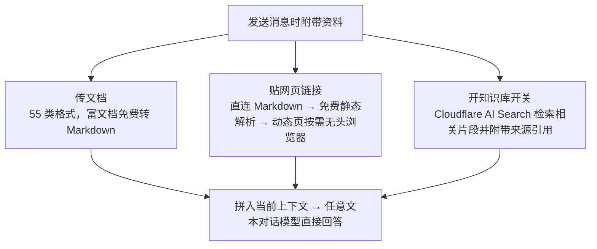

Cloudflare AI Web 6.0 已经正式发布。

这个开源项目基于 Cloudflare Workers AI 与 AI Gateway，把聊天记录、模型排列和个人设置全部保存在浏览器本地，支持一键部署到 Cloudflare Workers、Vercel 和 Docker，在线体验站位于 [ai.vuiki.com](https://ai.vuiki.com)。

比起 5.x，6.0 是一次围绕日常体验的全面升级。除了将底层从 Next.js 换成更轻量的 TanStack Start 与 Vite 8，更直接的变化是补齐了几块呼声最高的新功能，同一会话里边聊边画图、访客自带 API Key、所有文本模型都能读文档抓网页查知识库、全新的 6 标签设置中心与独立用量账本，以及开箱即用的 PWA 离线访问。


## 一、聊天与生图合体，同一会话里边聊边改图

5.x 时期，生图被拆在一个独立页面里，历史记录也单独存放。聊完创意想出图需要切页面复制提示词，画完想让视觉模型帮忙看构图或润色提示词，还得先下载图片再传回聊天页。

6.0 删除了独立生图页面，全局收口成一个统一的模型选择器。在任意普通对话里切到生图模型，输入框会自动切入生图模式并展开参数面板，发出后直接把生成结果留在当前对话流中。


合并带来两个很顺手的连贯用法。

- **最多 4 张参考图连续改图**，像 FLUX.2、OpenAI Images、Gemini 这类支持参考图的模型，既可以从本地上传图片，也可以直接点选当前会话里刚刚生成的图片继续编辑。生图请求只看当前提示词和选中的参考图，不会被前文几十轮闲聊干扰。
- **切回视觉模型直接续聊**，刚画完图，把模型切回支持识图的对话模型就能接着讨论这张图，不用手动下载再上传。系统会按不同生图模型家族自动适配参数面板，切换模型时保留兼容参数，重画未锁 Seed 时自动重新随机并跳过缓存。

老用户升级也不用担心旧图丢失。首次打开 6.0 时，5.x 的旧生图记录会自动无损迁移为一条名为 `Image History` 的普通会话，照常浏览和重画。

## 二、AI Gateway 零密钥托管与访客自带 Personal Provider

日常用多模型客户端，大家往往既想白嫖 Workers AI 的免费模型，又想在同一个界面里顺手调用 OpenAI、Claude、Gemini 或 DeepSeek。5.x 需要把上游密钥和模型列表写进好几个环境变量里，维护成本高，也不够放心。

6.0 把外部模型分成站长配置与访客自带两条路线。

站长侧先把上游 API Key 托管在 Cloudflare AI Gateway 的 BYOK（全计划免费）或 Unified Billing 里，应用端只需一行 `CF_AI_GATEWAY_MODELS` 声明开放哪些模型，也支持 `dynamic/*` 动态路由，部署环境不再保存任何上游密钥。声明的外部模型会自动排在模型选择器最前面。

访客侧新增了 **Personal Provider**。打开 **设置 → 服务商**，访客可以填入自己的 API Key，接入 OpenAI、Anthropic、Google AI Studio、DeepSeek、Grok、Mistral、Groq、Cerebras、Perplexity AI、Cohere 共 10 家第三方服务商，连 OpenAI 和 Gemini 的生图模型也一并支持。


添加模型时可以直接一键拉取服务商的模型列表勾选，免去手动拼写模型 ID；网关既可以走当前部署站点的 AI Gateway，也可以填访客自己的 Cloudflare AI Gateway。

安全和隐私边界也提前立好了。访客的 API Key 仅保存在当前浏览器本地存储，服务端绝不落盘、不写入错误日志、也不会进入导出的备份文件；经由站长网关转发时，系统会强制要求携带访客自有 Key 并禁止动态路由，避免消耗部署方余额。此外，`CF_ACCOUNT_ID` 和 `CF_WORKERS_AI_TOKEN` 已改为可选变量，所有环境变量留空也能直接跑成一个清爽的纯个人多模型客户端。

## 三、传文档、贴网页、连知识库，所有文本模型平等可用

很多聊天客户端把读文档、抓网页和查知识库做成模型 Tool Calling，可 Workers AI 上大量免费轻量模型并不擅长稳定调用工具，一旦失败或者陷入重试循环，体验很差还容易耗光配额。

6.0 把三类外部资料统一前置到模型推理之前，由服务端先整理干净再拼进当轮上下文，所有文本对话模型都能平等受益。



- **文档附件**，单文件上限 4 MiB，单条消息最多 4 个附件，覆盖 40 种代码与纯文本格式以及 PDF、Word、Excel、Numbers、CSV、HTML、XML 等 15 种常见富文档。富文档由 Workers AI `toMarkdown` 转换且不消耗 Neurons 额度，提取结果按段落截断在 24,000 字符以内，浏览器本地只保留 Markdown 文本，不存原始大文件。
- **网页正文提取**，采用三级“零额度优先”策略。第一步直连请求，碰到原生支持 Markdown 输出的站点直接取用；第二步下载静态 HTML，只要不是纯客户端渲染的空白壳就免费转为 Markdown；只有遇到动态渲染网页或反爬页面，且站长配了 `CF_BROWSER_RUN_TOKEN` 时，才按需调用 Cloudflare Browser Run 无头浏览器，遇到限流不反复重试，保护每天 10 分钟的免费配额，同时内置内网地址拦截等安全防护。
- **只读知识库（RAG）**，接入 Cloudflare AI Search，站长在 `CF_AI_SEARCH_INSTANCES` 白名单里配置可用实例。对话时开启知识库开关，系统会结合最近几轮对话检索最相关的 5 条片段注入上下文，并在回复下方附带来源和简短摘录，重试时会重新检索更新。

## 四、全新 6 标签设置中心、模型编排与独立用量账本

6.0 将原本局促的设置弹窗升级为独立的 6 标签设置中心，拆分为常规、模型、服务商、语音、用量和数据六个页面。

**自由编排模型列表。** 在 **设置 → 模型** 页面，模型太多时可以隐藏不常用项、新建自定义分组、重命名或整组隐藏，也支持拖拽调整分组与模型的顺序，把顺手的模型放在最上面，并支持一键清理上游已下线的失效条目。

**独立用量账本（Usage Ledger）。** 传统本地统计通常靠遍历留存聊天记录求和，只要删掉旧会话或点重试覆盖回答，实际花掉的 Token 和费用就从统计里消失了。6.0 在 **设置 → 用量** 维护了一本独立账本，每条回复完成即记录 Token、模型名与估算费用。


用量页支持切换 7 天、30 天和 90 天视图，展示按日堆叠的 Top 5 模型费用柱状图以及可排序明细表。Workers AI 自动按官方目录单价计算，外部与个人模型支持本地自定义单价，命中 AI Gateway 缓存的请求计为 `$0`。清空会话或反复重试都不会动到账本数据，导出备份也会一并带走并在导入时按 ID 合并。

**一批贴心的日常体验补充。**

- 浏览器原生语音输入与朗读，动口就能发消息、听回复。
- 自定义系统提示词（Custom Instructions）与 AI Gateway 缓存开关。
- 对话记录 JSON 完整备份导出与导入，可选是否包含聊天图片。
- 输入框底部清晰拆分“下一轮实际发给模型的消息数”与“模型实报的上下文窗口占用率”，悬停在助手回复上可直接看到生成模型名称。
- 支持通过 `APP_ANNOUNCEMENT` 在右上角配置多语言公告条，用户关闭后不会重复打扰，直到公告内容变更才再次提示。

## 五、PWA 离线翻记录、流畅度提升与更轻的底层

6.0 补上了 PWA 支持，可以直接安装到桌面或手机主屏。首次访问后即使断网，依然可以离线打开应用翻看本地保存的聊天记录与图片。缓存策略保持克制，所有对话接口从不缓存，首访也不会一口气预加载用不到的代码高亮语言包。

渲染流畅度也有针对性改善。Markdown、数学公式与代码高亮改为按需加载，不拖慢首页首次打开；高速流式回复采用 50 毫秒批处理与按行增量代码高亮，输出大段代码时滚动依然顺滑。

顺带提一句底层升级带来的实在好处。6.0 从 Next.js 16 切到了 TanStack Start 加 Vite 8，页面退回纯静态外壳。部署在 Cloudflare Workers 免费计划上时，访问首页、切设置页和刷新历史链接全部由静态资产直出，不再白白消耗 Workers 的免费 CPU 额度，只有真正发消息、生图和预处理资料才触发 Worker。同时延续一套代码自动适配 Cloudflare Workers、Vercel 和 Docker 三端部署。

## 5.x 升级到 6.0 快速清单

如果你已经在自托管 5.x，升级前核对这四项即可顺利切换。

1. **Vercel 修改 Framework Preset**，在项目设置的 Build and Deployment 中将 Framework Preset 改为 `Other`，清空自定义的 Build Command 与 Output Directory 后重新部署。
2. **迁移外部模型环境变量**，移除旧的 `CF_AI_GATEWAY_PROVIDERS`、`NEXT_PUBLIC_CF_AI_GATEWAY_PROVIDERS` 和 `GOOGLE_API_KEY`，把上游密钥托管进 Cloudflare AI Gateway BYOK，再用单行 `CF_AI_GATEWAY_MODELS` 声明外部模型。如果仅作个人多模型客户端，`CF_ACCOUNT_ID` 与 `CF_WORKERS_AI_TOKEN` 也可留空。

```bash
CF_AI_GATEWAY_MODELS="google-ai-studio/gemini-4-hydrogen?name=Gemini+4+Hydrogen&input=image,search&contextWindow=1048576,openai/gpt-5?input=image&reasoning=true&contextWindow=400000,dynamic/smart-chat?name=Smart+Chat"
```

3. **按需配置扩展变量**，需要抓取纯前端动态网页再配 `CF_BROWSER_RUN_TOKEN`，需要接入知识库再配 `CF_AI_SEARCH_TOKEN` 与白名单 `CF_AI_SEARCH_INSTANCES`。
4. **Docker 与浏览器数据无感迁移**，Docker 镜像保持原有启动方式；浏览器首次打开 6.0 会自动迁移旧偏好和生图历史，无需手动操作。

完整源码与部署文档位于 [github.com/Jazee6/cloudflare-ai-web](https://github.com/Jazee6/cloudflare-ai-web)，在线体验站运行在 [ai.vuiki.com](https://ai.vuiki.com)。
