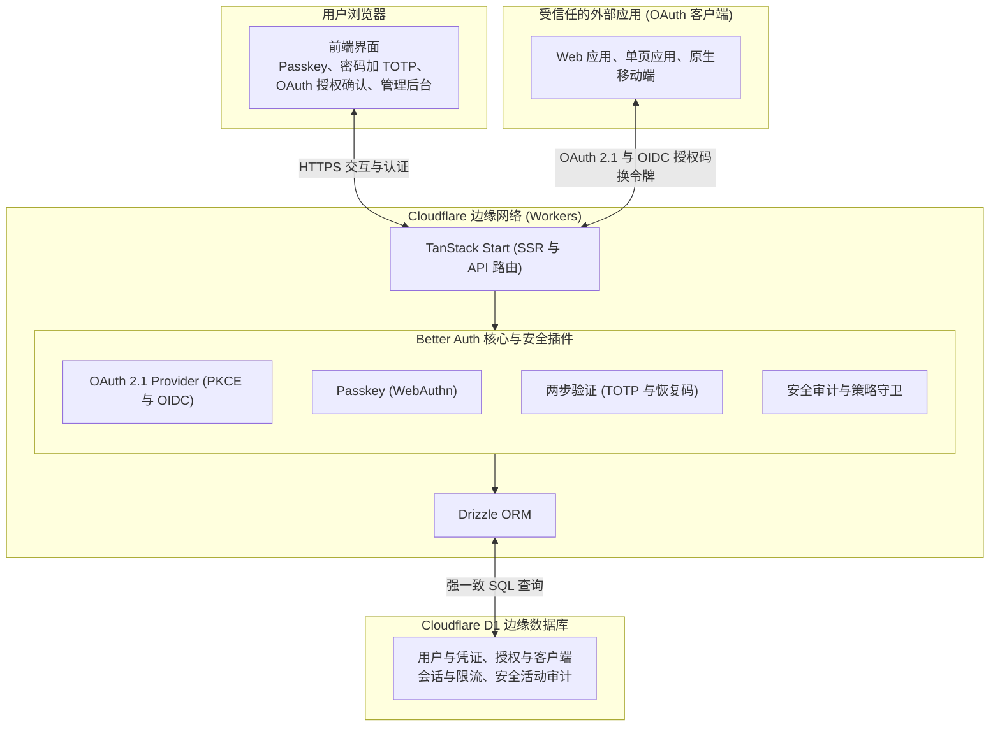
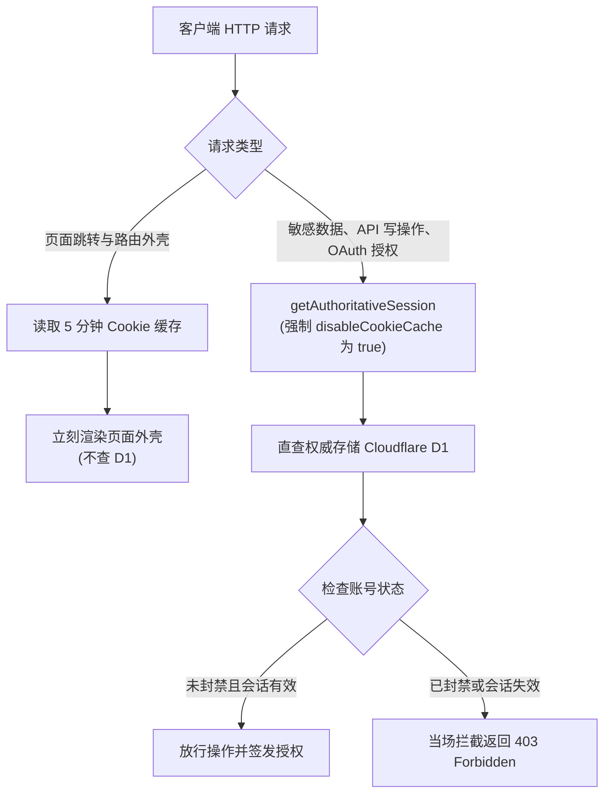
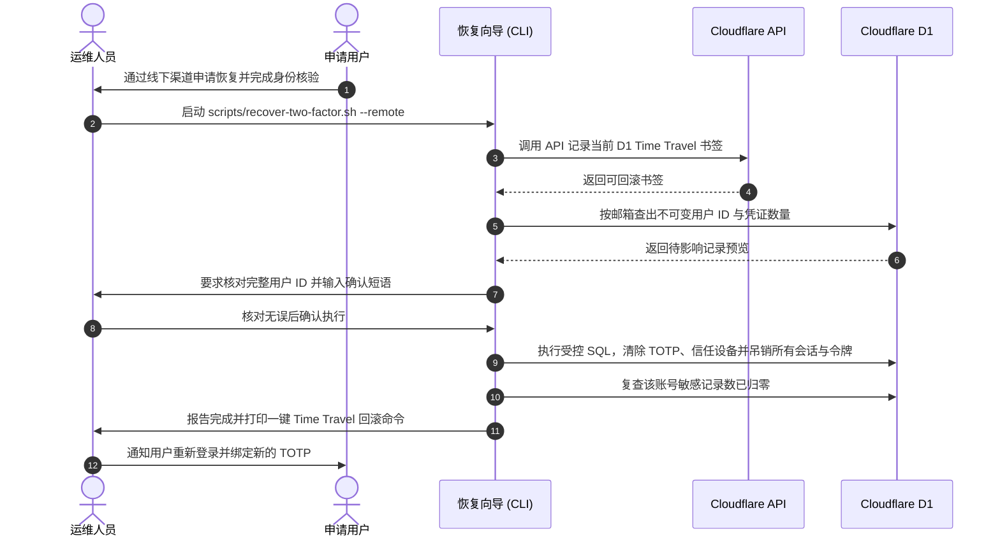

手头只要攒出三四个独立项目，单点登录这事迟早找上门。

一圈挑下来，主流开源方案比如 Keycloak、Zitadel、Ory Hydra，个个都得配一台常驻虚拟机，跑着 Java 或 Postgres。哪怕一个月只有两百次登录，CPU 和内存照样二十四小时烧着钱。去看商业 SaaS 吧，一旦你想跨应用签发 OAuth 令牌，账单立马蹦到几百美元一个月的企业版。

我不太服气，花了两个月，把一套完整的授权服务器硬生生搬上了 Cloudflare Workers 和 D1。没有常驻容器，没有 Redis，全跑在 Cloudflare 边缘网络上，每个月服务器账单正好是零。

不过真动起手来才发现，把一堆密码学签名、WebAuthn 认证流程和严格会话控制塞进无状态边缘运行时里，脚底下的坑比预想多得多。线上演示跑在 [account.vuiki.com](https://account.vuiki.com)，源码在 [Easy Auth](https://github.com/Jazee6/easy-auth)，下面结合真实代码聊聊我踩过的坑和做过的取舍。

## 为什么框架自带的登录库不够用

很多前端碰到认证需求，第一反应都是装个 NextAuth，现在叫 Auth.js，或者类似的框架登录库。

如果手里只有一个网站，拿 session cookie 记一下登录状态完全够使。可一旦业务长出三个以上独立域名，或者冒出手机端和桌面客户端，这套玩法马上就散架了。你总不能把用户密码库和数据库连接串，挨个发给每一个小项目。

这时候需要一块独立的身份信任域。核心系统自己攥着用户管理、TOTP 两步验证和 Passkey 凭证，外面的项目只当受信任的 OAuth 客户端，老老实实走标准的 OAuth 2.1 授权码加 PKCE 流程，换取访问令牌和 ID 令牌。

应用内的会话库，和独立的授权服务器，干的本来就是两码事。现有的自托管方案都挺成熟，就是全围着常驻机器设计的，冷启动慢、吃内存，养一台机器就为了几百次登录实在划不来。我就想试试，无服务器边缘网络到底能不能扛住这一套。

## 架构怎么搭，冷启动怎么压到 40 ms

Easy Auth 跑在 Cloudflare Workers 上，唯一的持久化存储是 Cloudflare D1，底层是分布式 SQLite。

前后端一体用了 TanStack Start。我直接放弃了把 Next.js 打包适配到 Workers 的路子，因为 TanStack Start 原生对着 Web Request 和 Response 标准写，不用背一层厚重的 Node.js 兼容垫片，边缘节点的冷启动因此稳稳压在 35 到 45 ms。



为了让冷启动一直这么快，表结构迁移绝不能放到 Worker 启动时动态跑。我平时都在本地拿 `drizzle-kit` 生成好 SQL 迁移文件，发版前由 CI 或者本地 Wrangler 提前打进 D1，Worker 运行时只管干常规的查询和业务写入。

```bash
bun run auth:generate
bun run db:generate
bun run db:migrate:local
```

认证核心交给 Better Auth，我写了个工厂函数，把核心功能和挑出来的几个插件组装在一起，代码节选长这样。

```typescript
// src/lib/auth-factory.ts
import { betterAuth } from "better-auth";
import { drizzleAdapter } from "better-auth/adapters/drizzle";
import { admin, jwt, twoFactor } from "better-auth/plugins";
import { oauthProvider } from "@better-auth/oauth-provider";
import { passkey } from "@better-auth/passkey";
import { drizzle } from "drizzle-orm/d1";
import * as schema from "../db/schema";
import { derivePasskeyRpConfig } from "./passkey-policy";
import { hasAdministratorRole } from "./oauth-policy";

export function createEasyAuth({ environment }: EasyAuthFactoryOptions) {
  const database = drizzle(environment.DB, { schema });
  const rpConfig = derivePasskeyRpConfig(environment.BETTER_AUTH_URL);

  return betterAuth({
    appName: "Easy Auth",
    baseURL: environment.BETTER_AUTH_URL,
    secret: environment.BETTER_AUTH_SECRET,
    database: drizzleAdapter(database, {
      provider: "sqlite",
      schema,
    }),
    session: {
      cookieCache: {
        enabled: true,
        maxAge: 5 * 60,
        strategy: "compact",
      },
    },
    plugins: [
      admin({ defaultRole: "user", adminRoles: ["admin"] }),
      jwt(),
      twoFactor({
        issuer: "Easy Auth",
        allowPasswordless: false,
        backupCodeOptions: { storeBackupCodes: "encrypted" },
      }),
      oauthProvider({
        loginPage: "/login",
        consentPage: "/consent",
        scopes: ["openid", "profile", "email", "offline_access"],
        grantTypes: ["authorization_code", "refresh_token"],
        allowDynamicClientRegistration: false,
        clientRegistrationRequirePKCE: true,
        refreshTokenReuseInterval: 0,
        storeClientSecret: "hashed",
        prefix: {
          clientSecret: "ea_cs_",
          opaqueAccessToken: "ea_at_",
          refreshToken: "ea_rt_",
        },
        clientPrivileges: ({ user }) => hasAdministratorRole(user?.role),
      }),
      passkey({
        rpID: rpConfig.rpID,
        origin: rpConfig.origin,
        rpName: rpConfig.rpName,
        authenticatorSelection: { userVerification: "required" },
      }),
    ],
  });
}
```

按默认配置装完，基本流程确实能跑起来。可一旦推到公网上接真实流量，好几个默认行为都会把安全边界撕开一条口子。下面挑几个上线前我下狠手改掉的地方细讲讲。

## 为什么自动按邮箱合并账号是个后门

不少认证库都有个默认替你省事的功能，用户拿 GitHub 登录，只要 GitHub 返回的已验证邮箱跟库里某个老账号对得上，系统就自动把两个账号合在一起，顺手把人放进去了。

用起来确实少点一下，可安全隐患大得吓人。

各家外部身份提供方对邮箱校验的松紧程度天差地别。有的平台改主邮箱根本不用二次确认，有的老系统里藏着校验逻辑漏洞。只要你的系统敢凭外部传回来的一串同名邮箱就自动合号，攻击者在外部服务抢注或篡改同一个邮箱，就能悄无声息把合法用户的账号接管掉。

我在架构决策记录 ADR-0001 里，把隐式绑定直接一刀切死了。

```typescript
// src/lib/auth-policy.ts
export const externalIdentityAuthPolicy = {
  requireEmailVerification: true, // 外部身份必须带已验证邮箱
  disableImplicitLinking: true,   // 绝不因为邮箱相同就自动合号
  allowDifferentEmails: true,     // 已登录账号可以主动绑定不同邮箱的外部身份
  updateUserInfoOnLink: false,
  allowUnlinkingAll: false,       // 账号必须至少留一种可用的登录方式
  // ...
} as const;
```

现在规则特别直白。外部身份带的邮箱在库里还没人用，开放注册就直接建新号。要是这个邮箱已经归某个老账号所有，而且从来没绑过这个外部身份，登录直接拒绝，请老老实实用原有密码或者 Passkey 先登进去，再去账号面板里自己点一下关联身份。

到了 1.0.1 版本，我顺手把跨邮箱绑定也加上了。

很多开发者 GitHub 挂着私人邮箱，进某个系统用的却是工作邮箱。只要你在已经登录的会话里主动发起绑定，两边邮箱不一样也能绑上去。外部身份的邮箱依然必须经过验证，绑定完也不会改掉原本的登录邮箱。因为发起操作的人已经自证了身份，这里不存在越权风险。

## 五分钟 Cookie 缓存提速，敏感操作必须直查 D1

说完绑定，再聊聊边缘架构里的性能与安全拉扯。

在 Workers 里，每次查 D1 都会给请求多垫一段网络延迟。Better Auth 自带一个五分钟的 Cookie 缓存，把关键会话字段签进客户端 Cookie 里，五分钟之内服务端路由和页面渲染直接读 Cookie，根本不用跑一趟 D1。

切页面、跳路由的时候丝滑得像本地应用。

可这玩意同时埋了颗雷。试想有个恶意账号正在搞破坏，管理员在后台点了封禁账号或者吊销全部会话。如果全走 Cookie 缓存，这个已经被封掉的人，在接下来整整 300 秒里手里还捏着有效会话，照样能接着调接口。

对于一个身份认证中心来说，放任被封禁的账号满大街再跑五分钟，绝对不能接受。

我的解法是 ADR-0005 里的双层会话策略。



凡是真要验权的地方，一律不用普通读取，统一换上 `getAuthoritativeSession`。

```typescript
// src/lib/authoritative-session.ts
import type { createEasyAuth } from "./auth-factory";

type SessionAuthApi = Pick<ReturnType<typeof createEasyAuth>["api"], "getSession">;

export function getAuthoritativeSession(authApi: SessionAuthApi, headers: Headers) {
  // 必须显式传 disableCookieCache 为 true，绕过缓存直查 D1
  return authApi.getSession({
    headers,
    query: { disableCookieCache: true },
  });
}
```

现在界线划得很死。页面外壳可以吃缓存，保证逛起来够快，可只要你手指点下授权给新应用或者修改安全设置，后端立刻去 D1 查你有没有被封。被封的人顶多还能瞥一眼静态面板的壳子，任何带副作用的操作都干不成。

## 别信 Host 请求头，Passkey 域名必须静态锁死

接着看 Passkey 这块。

WebAuthn 凭证和密码学域名是绑死的，浏览器每次弹窗让你按指纹或扫脸，认证器都会死抠依赖方标识 RP ID 和 Origin 对不对得上。

网上不少开源示例图省事，直接从请求头里拿 Host。

```typescript
// 危险写法，千万别拿请求头算 RP ID
const host = request.headers.get("host");
const rpID = host ? host.split(":")[0] : "localhost";
```

只要前面挂着反向代理、多源 CDN 或者预览环境，这种写法分分钟出大乱子。攻击者伪造一个 Host 头发起认证流程，或者不同环境的域名串了台，凭证就可能跨环境混用。

ADR-0006 里我定了个硬规矩，RP ID 和 Origin 必须从服务端环境变量 `BETTER_AUTH_URL` 静态算出来，运行时绝不碰任何 HTTP 请求头。

```typescript
// src/lib/passkey-policy.ts
export function derivePasskeyRpConfig(betterAuthUrl?: string): PasskeyRpConfig {
  if (!betterAuthUrl) {
    return {
      rpID: "localhost",
      origin: "http://localhost:3000",
      rpName: "Easy Auth",
    };
  }

  const url = new URL(betterAuthUrl);
  if (url.protocol !== "http:" && url.protocol !== "https:") {
    throw new Error(`Invalid BETTER_AUTH_URL protocol: "${betterAuthUrl}"`);
  }

  return {
    rpID: url.hostname,
    origin: url.origin,
    rpName: "Easy Auth",
  };
}
```

这么一锁，三个环境的边界铁板一块，本地开发是 `localhost`，预发走预发域名，生产钉死在 `account.vuiki.com`，谁也别想跨环境造假凭证。

代价我也提前说透，**要是哪天 Easy Auth 换了新根域名，老域名下注册过的所有 Passkey 在客户端都会全部失效**。用户得靠本地密码或者 GitHub 登进去，在新域名底下重新录一遍指纹。这个限制我直接写进文档摊开讲，跟堵死凭证伪造比起来，这点迁移成本值得认。

## 给 Admin 插件动刀，只留封禁和踢人

Better Auth 的 Admin 插件功能特别全，一口气提供了十几个接口，改用户资料、重设密码、扮演别人登录、改角色权限全都有。

放在多人协作的生产后台里，把这套接口原封不动放出去，等于满地撒横向提权的后门。哪个管理员要是想搞事，调一下 `/admin/set-role` 就能给自己加权，调一下 `/admin/impersonate-user` 就能钻进别人账号里晃悠。

我在中间件层按 ADR-0004 做了默认全拒。

```typescript
// src/lib/admin-policy.ts
const directAdminPluginPaths = new Set([
  "/admin/set-role",
  "/admin/get-user",
  "/admin/create-user",
  "/admin/update-user",
  "/admin/list-users",
  "/admin/list-user-sessions",
  "/admin/unban-user",
  "/admin/ban-user",
  "/admin/impersonate-user",
  "/admin/stop-impersonating",
  "/admin/revoke-user-session",
  "/admin/revoke-user-sessions",
  "/admin/remove-user",
  "/admin/set-user-password",
  "/admin/has-permission",
]);

// 生产环境里，管理员只拿到四个核心处置动作
export function isAllowedDirectAdminPluginPath(path: string | undefined): boolean {
  return (
    path === "/admin/ban-user" ||
    path === "/admin/unban-user" ||
    path === "/admin/revoke-user-session" ||
    path === "/admin/revoke-user-sessions"
  );
}
```

名单以外的 Admin 接口，请求刚进中间件就被 403 Forbidden 拍回去了。

账号也分了普通用户和管理员两层。管理员能封禁普通账号、踢掉他们的登录设备，可目标一旦也是管理员，接口直接拒掉。想动管理员账号，只能由手里有 D1 底层权限的运维亲自出手。后台页面里展示的用户列表全靠手写 Drizzle 字段投影来查，会话令牌和敏感哈希压根不会序列化发给前端。

## 丢了 2FA 怎么办，为什么不用邮件重置而用 D1 Time Travel

聊到两步验证，市面上很多产品的做法挺讽刺的。

系统先苦口婆心让你开了 TOTP，还让你抄了一堆恢复码。结果你到了登录页点一下「验证器丢了」，页面立马热情弹个按钮，问要不要往注册邮箱发一封 2FA 重置链接。

这一下就把两步验证的根给刨了。如果第一因素也就是邮箱，能单方面把第二因素关掉，那在安全模型里你的第二因素跟没装一样。谁撬开了你的邮箱，点一下就能把 TOTP 卸掉。

Easy Auth 前端故意不做任何自助重置 2FA 的入口。如果有人手机上的验证器丢了，恢复码也全弄丢了，唯一的路就是走**离线人工运维恢复**。

我专门写了套交互式终端脚本 `scripts/recover-two-factor.sh` 来干这事。

```bash
# 对生产库执行 2FA 恢复向导
scripts/recover-two-factor.sh --remote
```

运维人员得先通过线下渠道核实本人身份，再跑这套向导。



这里借了个特别顺手的特性，Cloudflare D1 自带的 **Time Travel**。动刀子改数据之前，脚本会先打一个当前数据库状态的书签。万一运维手抖输错了邮箱，或者事后发现申请人身份存疑，照着脚本吐出来的命令几秒就能把数据库原样退回那一刻。

恢复跑完以后，这个账号在 Easy Auth 里的全部会话、存下来的 OAuth 刷新令牌和不透明访问令牌都会一并作废，下次登录必须重绑一套新的 TOTP 密钥。当然也有管不到的边界，已经发给外部应用的 ID 令牌，还有外部应用自己建的本地会话，认证中心收不回来，只能等它们按各自的有效期自然过期。

## Workers 运行时的一个暗坑，发邮件为什么不能直接去掉 await

注册验证码和密码重置邮件都走 Resend 的 HTTP API。

第一版我直接 `await` 了发信接口，结果一个普普通通的注册请求，耗时直接从 30 ms 飙到了 650 ms，绝大部分时间全耗在跨机房的网络握手上。

当时我自作聪明想了个快招，把 `await` 删掉，让邮件在后台自己慢慢发，接口先给前端回个 200。

```typescript
// 严重错误，在 Cloudflare Worker 里千万别这么写
resend.emails.send({ ... }); // 去掉 await，指望它在后台悄悄发完
return Response.json({ success: true });
```

本地跑 Vite 开发环境一切正常，一封没丢。

结果一推到 Cloudflare Workers 线上，验证码邮件开始大面积人间蒸发。查下来才明白，Workers 跑在 V8 isolate 的事件循环模型上，只要当前请求的 Response 一返回，运行时看没有登记在案的待办任务，扭头就把这个实例挂起甚至销毁了。那个没挂钩的 Promise 当场被砍死。

正确解法是用 Workers 专门给的 `waitUntil`。我把它接进了 Better Auth 的 `advanced.backgroundTasks` 钩子里，库里发起的所有后台任务都统一走这儿。

```typescript
// src/lib/email-service.ts
export function scheduleBackgroundTask(
  task: Promise<unknown>,
  waitUntil: (task: Promise<unknown>) => void,
  onError: (error: unknown) => void = (error) =>
    console.error("Background email delivery failed", error),
): void {
  // 告诉 Workers 运行时，这项任务不阻塞响应，但在它跑完前别把上下文冻住
  waitUntil(task.catch(onError));
}
```

换上 `waitUntil` 之后，浏览器 25 ms 内就能拿到注册响应，邮件的 HTTP 握手在后台安安稳稳跑完，速度保住了，验证码邮件也一封没漏。

## 外部应用怎么接进来

认证中心跑稳了，外面的项目接起来其实挺轻巧。Easy Auth 暴露了标准的 OIDC 发现端点 `/.well-known/openid-configuration`。

就拿我自己开源的另一个项目 [Web Chat](https://github.com/Jazee6/web-chat) 来说，客户端用 Better Auth 的 `genericOAuth` 插件，十几行配置就接完了标准的 OIDC 登录。

```typescript
// 外部应用客户端配置示例（Web Chat）
import { betterAuth } from "better-auth";
import { genericOAuth } from "better-auth/plugins/generic-oauth";

export const auth = betterAuth({
  // ...
  plugins: [
    genericOAuth({
      config: [
        {
          providerId: "idp",
          // 例如 https://account.vuiki.com/api/auth/.well-known/openid-configuration
          discoveryUrl: env.OAUTH_DISCOVERY_URL,
          clientId: env.OAUTH_CLIENT_ID,
          clientSecret: env.OAUTH_CLIENT_SECRET,
          authentication: "basic", // 客户端注册时采用 client_secret_basic
          pkce: true, // 用 PKCE 防止授权码被截获
          requireIdTokenVerification: true,
          scopes: ["openid", "profile", "email"],
          overrideUserInfo: true,
        },
      ],
    }),
  ],
});
```

如果外部应用走的是 [无状态会话管理](https://www.better-auth.com/docs/concepts/session-management#stateless-session-management)，甚至连自己的会话表都不用建。在创建用户的钩子里，直接把本地用户 ID 钉成 Easy Auth 签出来的 `sub` 就行。

```typescript
// 在无状态外部应用中对齐全局用户 ID
export const authConfig: BetterAuthOptions = {
  databaseHooks: {
    user: {
      create: {
        before: (user) => {
          return {
            data: {
              ...user,
              id: user.sub, // 对齐 Easy Auth 的不可变主体标识
            },
          };
        },
      },
    },
  },
};
```

这样外部应用既保留了 JWT 加 Cookie 的无状态轻便，底下又跟全局身份域严丝合缝对得上号。

## 坦白说，这套方案也有三个妥协

没有哪套架构包治百病，为了够轻、够贴合边缘环境，Easy Auth 有三处明面上的取舍。

先说 **跨应用共享公开的 `sub`（ADR-0002）**。Easy Auth 发给每个 OAuth 客户端的 ID 令牌里，`sub` 字段直接填的就是内部不可变用户 ID。在我自己几个产品之间打通数据确实省事，可理论上不同的外部应用也能拿 `sub` 把同一个人关联起来，目前不支持按客户端隔离的成对匿名标识。

再就是 **客户端归单个管理员名下（ADR-0003）**。每个注册好的 OAuth 客户端都挂在创建它的管理员用户 ID 底下，目前还没做企业级团队协作角色。哪天管理员离职交接，运维得去 D1 里跑一行 SQL，手动改一下 `oauthClient.userId`。

最后绕不开的是 **D1 的写入并发上限**。D1 底层是分布式 SQLite，读得飞快、边缘同步也快，但写操作依然逃不开单写入者规则。要是突然涌进来大批人集中注册，写吞吐肯定干不过分布式 Postgres。不过对中小独立项目来说，离那个天花板还远着呢。

## 源码与试用

不租云服务器、不折腾 Docker 容器，把一套带 OAuth 2.1、Passkey 和 TOTP 的身份认证中心塞进 Cloudflare Workers 和 D1，这条路我已经替大家踩通了。

全部代码开源在 [Jazee6/easy-auth](https://github.com/Jazee6/easy-auth)，线上演示地址是 [account.vuiki.com](https://account.vuiki.com)。如果你也在找一套闲置时不花钱、用户数据又捏在自己手里的轻量身份服务，欢迎直接拿去改着玩，碰到问题也随时来聊。
