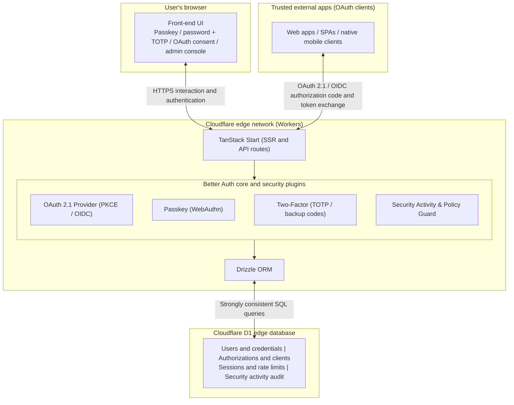
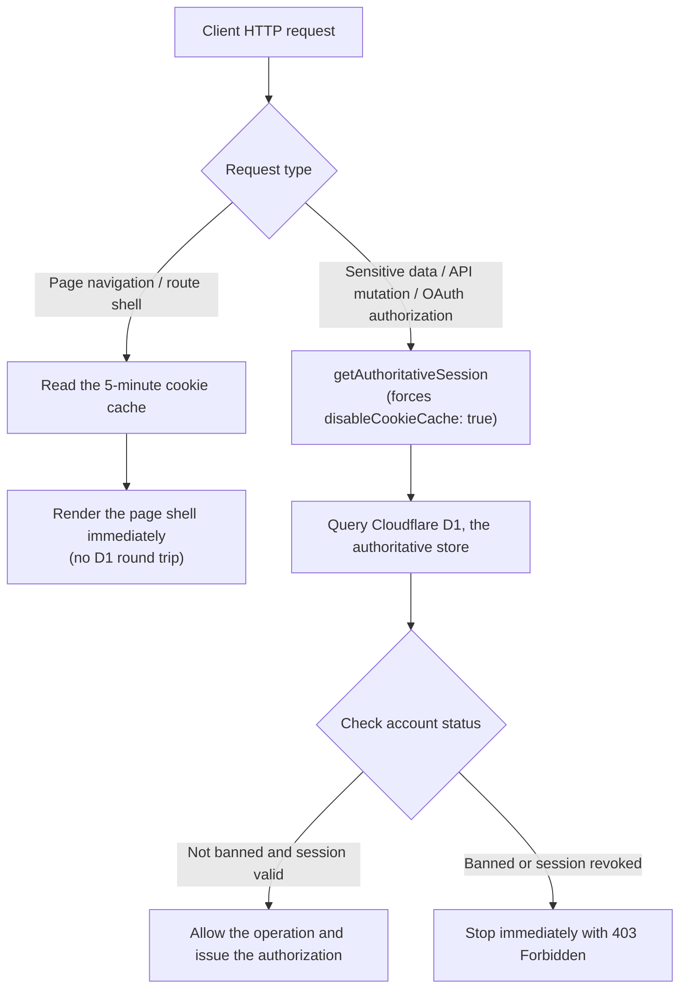
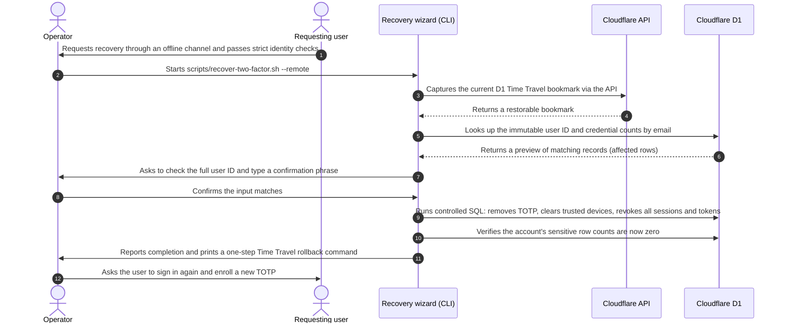

If you want a single sign-on system for several independent projects, most open-source options push you toward an always-on VM running Java or Postgres, while commercial SaaS products push you into an enterprise plan costing hundreds of dollars a month the moment you need to issue OAuth tokens across apps.

I spent two months moving a complete authorization server onto Cloudflare Workers and D1. No always-on containers, no Redis, nothing but Cloudflare's edge network, and a monthly server bill of zero.

But moving a system full of cryptographic signatures, WebAuthn ceremonies and strict session control into a stateless edge runtime turned up far more pitfalls than I expected. This post walks through the architecture of [Easy Auth](https://github.com/Jazee6/easy-auth) (live demo: [account.jaze.top](https://account.jaze.top)) and the specific trade-offs I made between security and edge performance.

## Why Framework Auth Wasn't Enough

The first instinct of many front-end developers is NextAuth (Auth.js) or a similar framework library.

But there is a fundamental distinction here: an in-app session library is not an authorization server.

If you only have one website, tracking sign-in state with a session cookie is all you need.

Once you have three or more independent domains, a mobile app or a desktop client, that model falls apart quickly. You can't hand out user passwords and database connection strings to every small project. What you need is a separate identity trust domain: a core system owns user management, TOTP verification and Passkey credentials, and outside apps act only as trusted OAuth clients, exchanging the standard OAuth 2.1 authorization code flow with PKCE for access tokens and ID tokens.

The existing self-hosted options (Keycloak, Zitadel, Ory Hydra) are solid, but they're designed around always-on servers. They start slowly and use plenty of memory, and even with only two hundred sign-ins a month, you still pay for CPU and memory that are always on.

I wanted to see whether this could work on a serverless edge network.

## Architecture and Edge Topology

Easy Auth runs on Cloudflare Workers, and its only persistent store is Cloudflare D1 (distributed SQLite).

TanStack Start drives both the front end and the server. I gave up on wrapping Next.js for Workers, because TanStack Start targets the native Web Request/Response standard directly, without a bloated Node.js compatibility shim, which keeps edge cold starts consistently between 35 ms and 45 ms.



To keep cold starts fast, schema migrations must never run dynamically when the Worker starts.

I generate the SQL migration files locally with `drizzle-kit`, and CI or a local Wrangler applies them to D1 ahead of time, so the Worker runtime only does ordinary reads and business writes:

```bash
bun run auth:generate
bun run db:generate
bun run db:migrate:local
```

Better Auth powers the authentication core. A factory function combines the core features with a controlled set of plugins (abridged):

```typescript
// src/lib/auth-factory.ts
import { betterAuth } from "better-auth";
import { drizzleAdapter } from "better-auth/adapters/drizzle";
import { admin, jwt, twoFactor } from "better-auth/plugins";
import { oauthProvider } from "@better-auth/oauth-provider";
import { passkey } from "@better-auth/passkey";
import { drizzle } from "drizzle-orm/d1";
import * as schema from "../db/schema";
import { derivePasskeyRpConfig } from "./passkey-policy";
import { hasAdministratorRole } from "./oauth-policy";

export function createEasyAuth({ environment }: EasyAuthFactoryOptions) {
  const database = drizzle(environment.DB, { schema });
  const rpConfig = derivePasskeyRpConfig(environment.BETTER_AUTH_URL);

  return betterAuth({
    appName: "Easy Auth",
    baseURL: environment.BETTER_AUTH_URL,
    secret: environment.BETTER_AUTH_SECRET,
    database: drizzleAdapter(database, {
      provider: "sqlite",
      schema,
    }),
    session: {
      cookieCache: {
        enabled: true,
        maxAge: 5 * 60,
        strategy: "compact",
      },
    },
    plugins: [
      admin({ defaultRole: "user", adminRoles: ["admin"] }),
      jwt(),
      twoFactor({
        issuer: "Easy Auth",
        allowPasswordless: false,
        backupCodeOptions: { storeBackupCodes: "encrypted" },
      }),
      oauthProvider({
        loginPage: "/login",
        consentPage: "/consent",
        scopes: ["openid", "profile", "email", "offline_access"],
        grantTypes: ["authorization_code", "refresh_token"],
        allowDynamicClientRegistration: false,
        clientRegistrationRequirePKCE: true,
        refreshTokenReuseInterval: 0,
        storeClientSecret: "hashed",
        prefix: {
          clientSecret: "ea_cs_",
          opaqueAccessToken: "ea_at_",
          refreshToken: "ea_rt_",
        },
        clientPrivileges: ({ user }) => hasAdministratorRole(user?.role),
      }),
      passkey({
        rpID: rpConfig.rpID,
        origin: rpConfig.origin,
        rpName: rpConfig.rpName,
        authenticatorSelection: { userVerification: "required" },
      }),
    ],
  });
}
```

The default plugin setup gets the basic flows working, but once it faces real traffic on the public internet, many of the defaults don't respect strict security boundaries.

Here are the key architectural trade-offs I made while putting it into production.

## Why Implicit Email Merging Becomes an Account Takeover Backdoor

Many auth libraries ship with a default behavior: if a user signs in with GitHub and the verified email GitHub returns matches an existing account, the system automatically links the GitHub account to that account and signs the user in.

On the surface, this is a convenience.

In practice, it's a serious security hole.

Identity providers don't all verify email the same way. Some let you change your primary email without a second confirmation; others have logic flaws in legacy systems. If the system merges accounts based on nothing more than a matching email from outside, an attacker can register the same email with an external service and silently take over a legitimate account.

My architecture decision record (ADR-0001) turns implicit linking off entirely:

```typescript
// src/lib/auth-policy.ts
export const externalIdentityAuthPolicy = {
  requireEmailVerification: true, // external identities must come with a verified email
  disableImplicitLinking: true,   // never merge accounts just because the emails match
  allowDifferentEmails: true,     // a signed-in account may explicitly link an identity with another email
  updateUserInfoOnLink: false,
  allowUnlinkingAll: false,       // an account must keep at least one working sign-in method
  // ...
} as const;
```

The rules are now clear:
1. If a user signs in with an external identity whose email no account uses yet, open registration can create a new account.
2. If that email already belongs to an account that has never linked this external identity, the sign-in is rejected, and the user is asked to sign in with an existing credential (password or Passkey) first.
3. The user must then go to the account panel and click "Link identity" from within that signed-in session.

In version 1.0.1, I went a step further and added cross-email linking.

Many developers use a personal email as their GitHub primary address but a work email on a particular system. As long as you start the linking flow from your current authenticated session, the system lets you link explicitly even if the two emails differ. The external identity's email still has to be verified, and linking never changes the account's login email. Because whoever started the flow has already proven who they are, there's no privilege escalation risk.

## Trading a 5-Minute Cookie Cache for SSR Speed, While Sensitive Checks Go Straight to D1

In a serverless edge architecture, every D1 query adds latency to the request.

Better Auth offers an optimization: a five-minute cookie cache. The key session fields are stored in a signed cookie on the client, and for five minutes, server routes and components can read the user straight from the cookie without querying D1.

This is great for page rendering and route transitions; navigation feels almost instant.

But it also plants a time bomb.

Suppose an abusive account is in the middle of doing damage, and an administrator clicks "Ban account" or "Revoke all sessions". Under cookie-cache logic, the banned user still counts as having a valid session for the next 300 seconds and can keep calling the API.

For an identity provider, letting a revoked account run free for five minutes is unacceptable.

My answer is a two-tier session strategy (ADR-0005):



Everywhere a real permission check happens, I use `getAuthoritativeSession` instead of the regular read:

```typescript
// src/lib/authoritative-session.ts
import type { createEasyAuth } from "./auth-factory";

type SessionAuthApi = Pick<ReturnType<typeof createEasyAuth>["api"], "getSession">;

export function getAuthoritativeSession(authApi: SessionAuthApi, headers: Headers) {
  // disableCookieCache: true must be passed explicitly to bypass the cache and hit D1
  return authApi.getSession({
    headers,
    query: { disableCookieCache: true },
  });
}
```

Now the line is sharp: the page shell may come from the cache, but the moment you click "Authorize this new app" or "Change security settings", the system checks D1 to see whether you've been banned.

A banned account might still glimpse a static dashboard, but it can never perform an operation with side effects.

## Never Trust the Host Header: Why the Passkey RP ID Must Be Statically Bound

Passkeys (WebAuthn) are cryptographically bound to domains. Every time the browser prompts for a signature, the authenticator strictly checks the Relying Party ID (RP ID) and origin.

Many open-source examples online do this:

```typescript
// A dangerous anti-pattern: deriving the RP ID from a request header
const host = request.headers.get("host");
const rpID = host ? host.split(":")[0] : "localhost";
```

Behind reverse proxies, CDNs with multiple origins, or preview environments, this can open disastrous security holes. If an attacker starts a ceremony with a forged Host header, or domains get mixed up between environments, credentials may end up reused across environments.

My architecture (ADR-0006) requires the RP ID and origin to be derived statically from the server-side environment variable `BETTER_AUTH_URL`, never from any HTTP request header at runtime:

```typescript
// src/lib/passkey-policy.ts
export function derivePasskeyRpConfig(betterAuthUrl?: string): PasskeyRpConfig {
  if (!betterAuthUrl) {
    return {
      rpID: "localhost",
      origin: "http://localhost:3000",
      rpName: "Easy Auth",
    };
  }

  const url = new URL(betterAuthUrl);
  if (url.protocol !== "http:" && url.protocol !== "https:") {
    throw new Error(`Invalid BETTER_AUTH_URL protocol: "${betterAuthUrl}"`);
  }

  return {
    rpID: url.hostname,
    origin: url.origin,
    rpName: "Easy Auth",
  };
}
```

This locks the environment boundaries in place: local development is `localhost`, staging has its own domain, and production is `account.jaze.top`. There's no way to spoof credentials between them.

The known cost of this decision: **if Easy Auth ever moves to a new root domain, every Passkey registered under the old domain stops working on the client.**

Users have to sign in another way (local password or GitHub) and register their biometrics again under the new domain. I document this constraint openly, because preventing credential forgery is worth the cost of static binding.

## Trimming the Admin Plugin: Default-Deny for Everything but Bans and Session Revocation

Better Auth's Admin plugin is very complete, with more than a dozen endpoints for editing users, resetting passwords, impersonation, role assignment and more.

But in a production system with several administrators, exposing that API as-is leaves countless backdoors for lateral privilege escalation.

For example, an administrator could quietly promote themselves through `/admin/set-role`, or act as another user through `/admin/impersonate-user`.

I enforce a strict default-deny policy in the middleware layer (ADR-0004):

```typescript
// src/lib/admin-policy.ts
const directAdminPluginPaths = new Set([
  "/admin/set-role",
  "/admin/get-user",
  "/admin/create-user",
  "/admin/update-user",
  "/admin/list-users",
  "/admin/list-user-sessions",
  "/admin/unban-user",
  "/admin/ban-user",
  "/admin/impersonate-user",
  "/admin/stop-impersonating",
  "/admin/revoke-user-session",
  "/admin/revoke-user-sessions",
  "/admin/remove-user",
  "/admin/set-user-password",
  "/admin/has-permission",
]);

// In production, administrators get only four critical enforcement actions
export function isAllowedDirectAdminPluginPath(path: string | undefined): boolean {
  return (
    path === "/admin/ban-user" ||
    path === "/admin/unban-user" ||
    path === "/admin/revoke-user-session" ||
    path === "/admin/revoke-user-sessions"
  );
}
```

Any Admin plugin endpoint that isn't on the list is stopped with 403 Forbidden as soon as the request reaches the middleware.

I also split accounts into regular accounts and administrator accounts. Administrators can ban regular accounts and sign out their devices, but if the target is itself an administrator, the endpoint refuses. Acting on an administrator account has to be done by hand by an operator with low-level access to the D1 database.

Every user list in the admin interface is queried through hand-written Drizzle projections, so session tokens and sensitive hashes are never serialized to the front end.

## Lost Your 2FA? Why I Use a D1 Time Travel Script Instead of Email Resets

Many products' 2FA designs have an ironic hole:

The system has you turn on TOTP and generates backup codes. But when you click "Lost my authenticator" on the sign-in page, it helpfully offers a button: "Email a 2FA reset link to your registered address."

That undermines the whole point of two-factor authentication.

If your second factor can be reset unilaterally through your first factor (email), then as far as the security model is concerned, your second factor doesn't exist. Anyone who gets into your mailbox can switch off your TOTP in one click.

Easy Auth deliberately offers no self-service way to reset 2FA in the front end.

If an account loses the authenticator app on its phone and also loses every backup code, the only way back is the **offline, operations-only recovery procedure**.

I wrote an interactive terminal wizard for it, `scripts/recover-two-factor.sh`:

```bash
# Run 2FA recovery against production
scripts/recover-two-factor.sh --remote
```

The wizard must be run by an engineer with real operational access, after verifying the user's identity offline:



This leans on Cloudflare D1's **Time Travel** feature. Before the wizard changes anything, it captures a bookmark of the current database state. If the operator realizes they entered the wrong email, or the user's identity turns out to be disputed, the bookmark restores the database exactly within seconds.

Recovery revokes every Easy Auth session for the account, along with its stored OAuth refresh tokens and opaque access tokens, and the next time the account signs in, it must enroll a new TOTP secret. It can only revoke what Easy Auth stores, though: ID tokens already delivered to apps, and the apps' own local sessions, can't be recalled and expire under their own policies.

## A Workers Runtime Pitfall: Why Email Delivery Can't Just Be Awaited

Sign-up verification codes and password reset emails go out through Resend's HTTP API.

In the first version, I awaited the email API directly in the handler. A simple sign-up request jumped from 30 ms to 650 ms, most of it spent waiting on network handshakes across regions and data centers.

Then I came up with what I thought was a clever fix: drop the `await`, let the email send in the background, and return 200 to the front end right away.

```typescript
// A serious mistake: never do this in a Cloudflare Worker
resend.emails.send({ ... }); // no await, hoping it runs quietly in the background
return Response.json({ success: true });
```

Everything worked fine in local development with Vite.

But as soon as it shipped to Cloudflare Workers, verification emails started going missing in large numbers. It turned out that Cloudflare Workers run on a V8 isolate event-loop model: once the response for the current request has been returned and nothing registered is still pending, the edge node may suspend or tear down the Worker instance right away. That Promise, cut loose from its context, simply gets killed.

The right approach is the Workers-specific `waitUntil` mechanism. Easy Auth plugs it into Better Auth's `advanced.backgroundTasks` handler, so every background task the library starts goes through it:

```typescript
// src/lib/email-service.ts
export function scheduleBackgroundTask(
  task: Promise<unknown>,
  waitUntil: (task: Promise<unknown>) => void,
  onError: (error: unknown) => void = (error) =>
    console.error("Background email delivery failed", error),
): void {
  // Tells the Workers runtime: this task isn't on the response path,
  // but don't freeze the context until it finishes
  waitUntil(task.catch(onError));
}
```

With `waitUntil`, the browser gets the sign-up response within 25 ms, while the email's HTTP handshake finishes safely in the background. Responses stay fast, and no emails get lost.

## Connecting External Clients to Easy Auth

With the authorization server running, how do trusted external apps connect to it?

Easy Auth exposes the standard OIDC discovery endpoint: `/.well-known/openid-configuration`.

Take [Web Chat](https://github.com/Jazee6/web-chat), another app I've open-sourced, as an example. On the client side, Better Auth's `genericOAuth` plugin completes a standard OIDC integration in a few lines:

```typescript
// Example client configuration in an external app (Web Chat)
import { betterAuth } from "better-auth";
import { genericOAuth } from "better-auth/plugins/generic-oauth";

export const auth = betterAuth({
  // ...
  plugins: [
    genericOAuth({
      config: [
        {
          providerId: "idp",
          // e.g. https://account.jaze.top/api/auth/.well-known/openid-configuration
          discoveryUrl: env.OAUTH_DISCOVERY_URL,
          clientId: env.OAUTH_CLIENT_ID,
          clientSecret: env.OAUTH_CLIENT_SECRET,
          authentication: "basic", // the client is registered with client_secret_basic
          pkce: true, // PKCE guards against authorization code interception
          requireIdTokenVerification: true,
          scopes: ["openid", "profile", "email"],
          overrideUserInfo: true,
        },
      ],
    }),
  ],
});
```

If the external app uses [stateless session management](https://www.better-auth.com/docs/concepts/session-management#stateless-session-management), it doesn't even need database tables for sessions. It can pin its user ID to the `sub` issued by Easy Auth in the user-creation hook:

```typescript
// Unifying user IDs in a stateless external app
export const authConfig: BetterAuthOptions = {
  databaseHooks: {
    user: {
      create: {
        before: (user) => {
          return {
            data: {
              ...user,
              id: user.sub, // align with Easy Auth's immutable subject
            },
          };
        },
      },
    },
  },
};
```

That way the external app keeps the lightweight, stateless nature of distributed JWTs and cookies, while staying strictly consistent with the global identity domain underneath.

## Known Limitations and Honest Trade-offs

No architecture is a silver bullet. To stay minimal and edge-friendly, Easy Auth makes these known compromises:

1. **A shared public subject (ADR-0002)**: In the ID tokens Easy Auth issues to every OAuth client, the `sub` claim is simply the internal immutable user ID. That makes it easy to connect user data across my own products, but it also means that different apps could in theory correlate the same person through `sub` (pairwise pseudonymous identifiers aren't supported).
2. **Clients owned by a single administrator (ADR-0003)**: Every registered OAuth client belongs to the user ID of the administrator who created it; there's no enterprise-style team role model yet. If an administrator leaves, an operator has to run a one-line SQL update on `oauthClient.userId` directly in D1.
3. **D1 write concurrency limits**: D1 is distributed SQLite underneath. Reads are very fast and edge replication is quick, but writes still follow the single-writer rule. Under a sudden burst of mass sign-ups, write throughput falls short of distributed Postgres. For small and medium independent projects, though, that ceiling is still far away.

## Wrapping Up

Running a production-grade identity provider without renting a cloud server or setting up Docker containers is entirely feasible.

Easy Auth runs on Cloudflare Workers and D1 and, together with TanStack Start and Better Auth, provides modern OAuth 2.1, PKCE, passwordless Passkey sign-in and TOTP protection.

The code is fully open source: [Jazee6/easy-auth](https://github.com/Jazee6/easy-auth).

If you're also looking for lightweight identity infrastructure that doesn't charge you for idle resources and gives you full control of your user data, feel free to borrow from it and get in touch.
