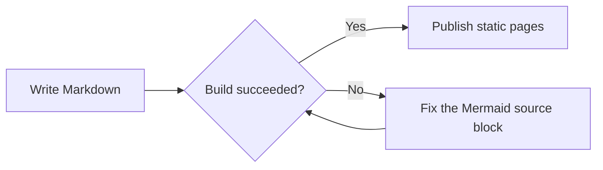

A comprehensive tour of Markdown syntax, showing the formatting features you will use most.

## Text Formatting

### Basic Text Styles

This is plain text.

**This is bold text**

*This is italic text*

***This is bold and italic text***

~~This is strikethrough text~~

`This is inline code`

### Blockquotes

> This is a blockquote.
>
> It can span multiple lines.
>
> > This is a nested quote.

## Lists

### Unordered Lists

- Item 1
- Item 2
    - Sub-item 2.1
    - Sub-item 2.2
        - Sub-sub-item 2.2.1
- Item 3

### Ordered Lists

1. First item
2. Second item
    1. Sub-item 2.1
    2. Sub-item 2.2
3. Third item

### Task Lists

- [x] A completed task
- [ ] A pending task
- [ ] Another pending task

## Code

### Inline Code

Use `console.log()` to print a message.

### Code Blocks

#### JavaScript

```javascript
function greet(name) {
    return `Hello, ${name}!`;
}

const message = greet('World');
console.log(message);
```

#### Python

```python
def fibonacci(n):
    if n <= 1:
        return n
    return fibonacci(n-1) + fibonacci(n-2)

# Print the Fibonacci sequence
for i in range(10):
    print(f"F({i}) = {fibonacci(i)}")
```

#### CSS

```css
.example {
    display: flex;
    justify-content: center;
    align-items: center;
    background: linear-gradient(45deg, #ff6b6b, #4ecdc4);
    border-radius: 8px;
    padding: 20px;
    box-shadow: 0 4px 6px rgba(0, 0, 0, 0.1);
}
```

## Mermaid Diagrams



## Links and Images

### Links

[GitHub](https://github.com)

[Relative link to the About page](/about)

[Link with a title](https://astro.build "Astro website")

### Autolinks

https://www.example.com

### Images


## Tables

| Feature    | Description                 | Supported |
|------------|-----------------------------|-----------|
| **Headings** | Multiple heading levels   | ✅         |
| **Lists**  | Ordered and unordered lists | ✅         |
| **Code**   | Syntax highlighting         | ✅         |
| **Tables** | Tabular data                | ✅         |
| **Links**  | Internal and external links | ✅         |

## Horizontal Rules

---

## Math (If Supported)

Inline: $E = mc^2$

Block:

$$
\sum_{i=1}^{n} i = \frac{n(n+1)}{2}
$$

## Special Characters and Escaping

- Copyright: &copy; 2024
- Trademark: &trade;
- Registered trademark: &reg;
- Arrows: &larr; &uarr; &rarr; &darr;

Escaping:

\*This is not italic\*

\`This is not code\`

## Footnotes

Here is a footnote reference[^1].

Here is another footnote[^note].

[^1]: This is the first footnote.

[^note]: This is a footnote with a named identifier.

## HTML Tags

<details>
<summary>Click to expand</summary>

This is a collapsible section.

- Markdown works here
- **Bold text**
- `Code`

</details>

<mark>Highlighted text</mark>

<kbd>Ctrl</kbd> + <kbd>C</kbd>

## Summary

This example covers the main Markdown features:

1. **Text formatting** - bold, italic, strikethrough
2. **Structured content** - headings, lists, tables
3. **Code** - inline code and code blocks
4. **Diagrams** - Mermaid flowcharts
5. **Media** - links and images
6. **Advanced features** - math, footnotes, HTML tags

Hope it helps you get started with Markdown!
